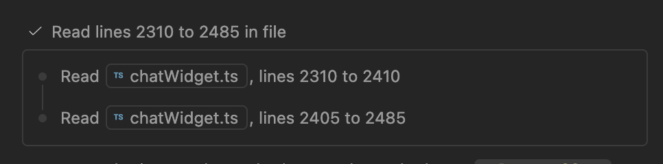

# AI 编码会话基本单元：思考、工具调用与过程折叠

研究日期：2026-10-19｜版本：v1.0 文档研究版｜视角：UX / UI

覆盖 Codex、Claude Code、DeepSeek Harness、WorkBuddy、Cursor、Windsurf / Cascade、GitHub Copilot（VS Code）。本文补充仓库已有的 [四产品结构分析页](index.html)，提供七产品对照、可追溯证据及 DevEco 交互建议。

## 1. 先回答这次的问题

**工具与思考过程常被压缩，但“默认折叠”不是统一行为。** 已核实的模式包括：工具详情收起、按视图密度隐藏、连续过程分组合并、完成后转为摘要，以及临时连接状态完成后消失。不能把它们都记成一个“是”。

证据最完整的是 Claude Code 桌面视图、VS Code 的工具配置，以及 WorkBuddy 的执行与 MCP 连接过程。Cursor 有明确的三档工具密度文档。DeepSeek Harness 的官方更新说明证明其有折叠工具卡与推理展开交互，但本轮未独立验证默认值。Codex App 和历史 Windsurf 的默认开合暂不能下确定结论。

**DevEco 的推荐方向：当前动作可见、成功详情按需展开、最终结果常驻；等待授权和失败保持可操作。** 这是设计建议，不是七款产品已经一致采用的规则。

### 研究边界

- 本轮为公开官方文档、更新日志和官方配图研究，没有登录七款产品执行同一任务。
- 官方配图可以证明某个画面存在，不能单独证明初始默认值或从生成中到完成的自动转换。
- 既有分析页中的源码结论作为历史材料保留；本报告未复现其源码检查，不把其中的像素尺寸和默认设置升级为新证据。
- 日期是资料访问日期；没有客户端版本号的结论只对所链接文档负责。
- 未验证的动画、流式输出节奏、默认密度、滚动锚定统一写“待实测”。

## 2. 把会话拆成可比较的基本单元

| 基本单元 | 用户需要知道什么 | 不能混淆的对象 |
|---|---|---|
| 思考 / 推理展示 | 是否仍在处理；是否理解正确 | 推理强度选择、推理摘要、可展示思考文本不是同一个功能 |
| 计划 / 待办 | 准备做什么、做到哪一步 | 计划不是完整思考，也不是执行成功凭证 |
| 工具调用 | 对什么对象做什么操作 | 调用参数、运行状态、调用结果应分开 |
| 工具结果 | 成功还是失败、输出是什么 | 工具执行成功不代表任务目标已达成 |
| 文件修改 | 哪些文件、改动规模与 diff | 对话中的说明不等于实际 diff |
| 验证结果 | 运行了什么、哪些通过或失败 | 未执行、执行失败、测试不通过是三种状态 |
| 授权请求 | 哪个动作正在等我、影响范围 | 与一般进度行分开，等待不能伪装成运行 |
| 最终答复 / 产物 | 做成了什么、如何验收、还有什么未完成 | 不应随过程组一起被隐藏 |

“深度思考”在本报告指可见的推理相关单元，不推断模型内部推理过程，也不以思考正文长度评价能力。

### 三层折叠 + 一个生命周期问题

| 层级 | 示例 | 研究字段 |
|---|---|---|
| L1 单次调用详情 | 一行“读取文件”，点开查看内容 | 默认开合、摘要字段、点击区域 |
| L2 连续步骤组 | 多次读取合并为一组 | 分组边界、标题、子步骤入口 |
| L3 整轮过程 | 一轮任务的过程收为一个入口 | 保留哪些结果、失败是否露出 |
| 生命周期 | 生成中显示，完成后摘要化或移除 | 自动变化触发时机、用户手动展开是否保留 |

## 3. 七产品总表

“文档确认”不代表本轮实机观察；“待实测”不等于产品不支持。

| 产品 / 客户端 | 思考单元 | 工具过程与展开方式 | 生成中 | 生成后 | 默认折叠结论 |
|---|---|---|---|---|---|
| Codex App | 本轮没有足够直接 UI 证据 | 官方协议区分命令、文件变更、MCP 等条目，不能推出实际样式 | 协议支持开始和增量事件 | 协议支持完成状态和最终输出 | **App 待实测**；不沿用 CLI 结论 [S1] |
| Claude Code 桌面 Code 页 | Thinking / Verbose 视图可显示 | Normal / Thinking 中工具压缩为摘要；Verbose 展示每步 | 文档明确可以边执行边停止或补充指令 | 视图策略适用于 transcript；未证实完成瞬间是否另有收起动画 | **Normal 中工具详情折叠**；初始选中模式待实测 [S2] |
| Claude Code 终端（同一产品的补充端） | 需区分普通对话与 transcript | Ctrl+O 打开详情；文档列出 MCP 多次调用合并摘要 | 具体各工具流式预览待实测 | 可回查详细执行记录 | **部分默认合并已确认**，不能推断所有工具 [S3] |
| DeepSeek Harness Web / Desktop | 更新日志提及推理展开与标题吸顶 | 官方日志明确存在可折叠工具卡 | 准备阶段可显示命令描述、路径和生成进度 | 收起卡内可直接访问 fetched URL | **支持折叠已确认，初始默认值待实测** [S4] |
| WorkBuddy 桌面 | 文档未明确独立思考单元；不能判定“没有” | 执行阶段说明、摘要、可展开中间步骤 | 阶段与消耗；MCP 连接计数 | MCP 加载过程不保留历史；不能类推所有工具过程 | **中间步骤可展开；通用默认策略未明确** [S5] |
| Cursor Agents Window（3.4 功能） | 本轮未确认思考默认开合 | Compact / Balanced / Detailed 三档控制工具过程密度 | 运行与结束的逐项差异待实测 | 档位控制会话可见信息量 | **密度可配置，默认选中档未核实** [S6] |
| Windsurf / Cascade | 公开文档不能确认独立思考呈现 | 现有文档确认 Todo、工具调用与 checkpoint | 长任务可在会话显示 Todo | 通过 checkpoint 回查/恢复；不证明过程折叠 | **历史 Windsurf 默认开合待核查**；原 URL 已跳转 Devin Desktop [S7] |
| VS Code Copilot Agent | 可用折叠 reasoning 区域；受设置影响 | 工具详情默认折叠，分组可配置 | 特定 persistent progress 模式下工具运行时保持可见 | Compact 模式在回答恢复/结束时把完成组改成可展开摘要；Verbose 保留 | **工具详情默认折叠已确认；整轮不能一概而论** [S8][S9] |

## 4. 逐产品：生成中、生成后与可借鉴点

### 4.1 Codex：先分清 App、CLI 和事件协议

官方 App Server 文档把 reasoning、命令执行、文件变更与 MCP 调用建成不同条目，配有 started / completed 和增量事件；命令还具有退出码、耗时等字段。它说明状态可以被结构化表达，**不证明 App 默认如何折叠**。[S1]

| 关注点 | 本轮结论 |
|---|---|
| 生成中 | 协议能表达开始、命令输出增量与推理摘要增量；实际 App 的状态行与预览待实测 |
| 生成后 | 协议区分最终条目状态；App 是否保留思考入口待实测 |
| 默认折叠 | 不将既有页对 CLI 的 transcript-only、输出预览行数、快捷键结论移植到 App |
| 展开详情 | 输入、输出、退出状态与变更是有价值的信息层次；实际入口待补图 |

**对 DevEco 的启发（设计推论）**：先定义条目状态及关联 ID，再设计折叠。这样“收起”只改变呈现，执行记录与验收证据仍能回查。缺图，见 [S1]。

### 4.2 Claude Code：思考可见度和工具密度是两个选择

桌面版文档列出 Normal、Thinking、Verbose 三种 transcript 视图：Normal 保留完整文本答复并将工具压为摘要；Thinking 在工具摘要之外显示思考；Verbose 展示完整工具与中间步骤。通过会话菜单或 Ctrl+O 切换。[S2]

这说明“显示思考”不必同时“展开所有工具”。生成中可停止或补充指令，但文档不足以确认流式思考如何裁切，以及完成瞬间是否自动收起。终端版的 Ctrl+O 查看器还会展开部分默认合并的行，例如多次 MCP 调用摘要。[S3]

**对 DevEco 的启发（设计推论）**：提供普通查阅和诊断查阅，让开发者按任务切换信息量；不要让用户逐个点开几十条记录才能排障。缺图，见 [S2][S3]。本报告不宣称三档中的某档是所有安装环境的初始默认值。

### 4.3 DeepSeek Harness：折叠存在，但插件改变行为

已确认对象为官方 `deepseek-ai/deepseek-harness`，不是 DeepSeek 普通聊天网页。官方 README 说明其处于 developer preview，采用插件架构。[S10]

官方发布记录提到：工具准备时显示已有参数信息；工具卡收起时可以直接打开已获取页面的链接；展开的推理标题支持吸顶。它们证明过程有渐进展示与折叠能力，但不能独立证明所有模式的初始开合或整轮收起时机。[S4]

社区 `dsh-trace-collapse` 插件明确提供最终输出出现后自动收起过程，并保留最终答案。这是**插件作者对其插件的说明，不是官方核心默认行为**。[S11]

**对 DevEco 的启发（设计推论）**：收起状态仍可携带文件/网页的直达入口；研究记录必须同时记下插件与配置，否则两个用户看到不同界面时容易误判。缺图，见 [S4][S10][S11]。

### 4.4 WorkBuddy：阶段状态与结果并行，临时进度可以退出历史

官方文档说明对话内呈现阶段、摘要和可展开中间步骤；MCP 连接中展示完成计数，全部就绪后该临时进度从历史流移除。[S5]


图 W1｜官方文档配图，未标客户端版本。能看到阶段说明、经过时间和写入文件状态；不能由静态图推断动效或最终折叠。它是通用任务示例，不是本轮编码任务实测。


图 W2｜连接数量是可辨识的等待反馈。完成后移除的规则来自文字文档，不是由这张图推测。图片中的蓝圈为官方配图标注，不是产品焦点样式。

**对 DevEco 的启发（设计推论）**：可以让一次性环境准备状态退出主对话，但命令执行、文件变更和测试结果应保留审计入口。文档没写独立思考单元，不能因此断言它不存在，也不能认定计划卡等同思考。

### 4.5 Cursor：密度成为会话层的控制项

Cursor 3.4（2026-05-13）的 Agents Window 更新提供三种工具密度：Compact 以简短结果为主，Balanced 包含重要中间过程，Detailed 提供接近完整的步骤上下文。**“接近完整”不能改写成“所有工具都默认展开”**。[S6]

生成中的活动行、完成后的自动合并、思考单元开合仍需指定版本与档位补测。当前证据支持“可控制信息量”，不支持推断默认选中 Balanced，也不支持把 Agents Window 与所有 IDE 面板、CLI 画面等同。

**对 DevEco 的启发（设计推论）**：密度最好作用于整段过程，而非改写日志；生成后仍可切档复核。缺图，见 [S6]。

### 4.6 Windsurf / Cascade：计划是显式进度，折叠仍需版本证据

原 Windsurf Cascade 文档已重定向到 Devin Desktop，页面描述 Todo、工具与 checkpoint。它支持把计划和具体动作分别呈现，但不足以证明历史 Windsurf 的工具详情默认开合。[S7]

**对 DevEco 的启发（设计推论）**：计划可回答“下一步是什么”；命令与测试回答“这一步做成没有”。需要分别保留这两种证据。历史客户端的思考样式、折叠策略和当前客户端是否一致仍待实测。缺图，见 [S7]。

### 4.7 GitHub Copilot / VS Code：把默认与实验配置明确分开

工具文档明确工具详情默认折叠，可展开查看调用与输出，连续调用的分组方式能通过配置改变。[S8]



图 V1｜2025-12 发布的 1.107 历史配图。当前图中组内两条读取记录处于可见状态，展示的是分组结构；“连续调用默认折叠”的结论来自该版本文字说明，而不是图中的当前展开状态。[S12]

现行文档进一步区分 persistent progress：启用时工具运行中保持可见；Compact 会在文本回答恢复或响应结束时，将完成组转为可展开摘要；Verbose 保留详情。该功能是实验配置，Stable 与 Insiders 的默认行为及实验推送可能不同。[S9]

**对 DevEco 的启发（设计推论）**：测试自动折叠时必须记录“何时触发”和“用户选了什么模式”。单凭一张完成截图无法判断产品有没有在运行中展示详情。

## 5. 同一编码场景下，用户需要的四层证据

以下是面向 DevEco 的任务旅程分析，非七产品同场景实测结果。

| 旅程行 | 理解代码 | 修改代码 | 构建 / 测试 | 遇阻与验收 |
|---|---|---|---|---|
| 行为 | 搜索符号、读取文件 | 修改相关文件 | 执行命令、读取结果 | 授权、定位失败、核对交付 |
| 界面触点 | 搜索组、读取行、文件直达 | 文件变更行、diff | 命令行、输出、通过/失败摘要 | 待处理卡、错误摘要、最终答复 |
| 情绪 / 摩擦 | 无反馈时怀疑卡住；逐条刷屏难看重点 | 不知道改了几处，担心范围扩大 | “完成”与“测试通过”混淆 | 自动收起可能隐藏待办，重试状态难理解 |
| 机会 | 当前动作可见，完成读取可分组 | 常驻改动数量与 diff 入口 | 摘要写明执行对象与退出状态 | 失败不藏、授权可操作、答案单独保留 |

## 6. 展示策略的收益与代价

| 策略 | 证据产品 | 收益（推论） | 代价（推论） |
|---|---|---|---|
| 视图分档 | Claude Code、Cursor | 降低逐项展开成本，兼顾普通查阅与诊断 | 切档入口难发现时，用户可能误以为记录丢失 |
| 连续步骤分组 | VS Code 1.107 | 压缩重复读取、搜索，便于跳读 | 标题泛化会掩盖不同文件与失败项 |
| 当前可见、完成摘要 | VS Code 特定配置 | 同时照顾执行监控和结果阅读 | 自动收起引起位移，可能打断正在查看的内容 |
| 临时状态退出历史 | WorkBuddy MCP 连接 | 避免环境准备信息长期占屏 | 若没有诊断记录，后续很难排查连接问题 |
| 插件控制整轮收起 | DSH 社区插件 | 可按个人偏好组织过程 | 环境差异增大，不能以插件行为代表核心产品 |

这些是可观察到的设计策略，不是完整 SWOT 或市场能力排名。本次没有足够数据对产品易用性打分。

## 7. DevEco 建议：先约定状态，再决定信息密度

### 7.1 建议的生成中 / 生成后规则

下表是候选交互规格，不描述 DevEco 当前实现。

| 单元 | 生成中 | 生成后 | 默认开合建议 | 应保留的入口 |
|---|---|---|---|---|
| 思考摘要 | 显示处理中状态与可用摘要；没有摘要时不虚构文本 | 留可回查入口；正文不抢占结果区域 | 正文收起 | 查看可展示摘要 |
| 读取 / 搜索 | 当前动作、对象与计数可见 | 连续成功项合并成组 | 详情收起 | 文件、搜索结果和每次调用 |
| 命令执行 | 命令、运行状态、最新输出可见 | 成功显示退出码与结果；失败显示错误摘要 | 成功日志收起，失败摘要常驻 | 完整命令、日志、工作目录 |
| 文件修改 | 文件名、修改中状态 | 文件数、增删规模与 diff 入口 | diff 按需展开 | 查看修改与文件直达 |
| 验证 | 显示实际执行任务 | 分开显示通过、失败、未执行 | 摘要常驻，详情收起 | 测试结果、构建日志 |
| 授权请求 | 明确等待用户，动作与范围完整可见 | 决策后保留简短记录 | 等待中展开 | 允许、拒绝、影响详情 |
| 最终答复 | 独立于工具流逐步呈现 | 保持可读 | 不随过程组收起 | 产物、变更和验证证据 |

### 7.2 三条优先落地建议

1. **P0：完成态必须说清做成什么。** 摘要至少包含修改对象、验证结果和未完成项。以“测试结束”替代“测试通过”会损害信任。验证：用户能否只读摘要正确判断可以提交还是仍需处理。
2. **P0：失败和待授权不被成功步骤盖住。** 分组标题保留失败数量与待办入口，正在查看的展开内容不因后台事件突然消失。验证：插入一次失败与一次授权，看用户能否找到阻塞动作及原因。
3. **P1：密度切换与执行数据分离。** 普通模式聚焦摘要，诊断模式保留详情；用户手动展开优先于自动收起。验证：切换密度后，调用顺序、日志、文件链接和错误记录均完整。

### 7.3 结构示意（DevEco 建议，非竞品截图）

```text
生成中
  当前：运行 hvigorw assembleHap                 [停止]
  已读取 4 个文件                               [查看步骤]
  已修改 2 个文件                               [查看 diff]
  > 编译模块 entry …                            [日志]

生成后
  已完成 · 修改 2 个文件 · 构建通过
  实现了列表缓存修复；真机验证尚未执行。
  [查看 diff] [构建结果] [展开 7 个过程步骤]

遇阻
  等待授权：执行命令 …                          [允许] [拒绝]
  或：构建失败 · 错误摘要 …                     [日志] [查看原因]
```

该示意只定义层级，不规定像素、颜色或组件新增。后续应复用仓库现有 AI 单元与状态规范。

## 8. 后续实测清单与验收标准

| 测试 | 必须采集的画面 | 要回答的问题 |
|---|---|---|
| 连续读取 5 个文件 | 首个动作、连续调用、最终答复 | 是否成组？组内失败会不会隐藏？ |
| 修改 2 个文件并运行测试 | 修改中、测试运行中、测试结束、答复完成 | 哪个事件触发收起？diff 是否常驻？ |
| 需要授权的命令 | 请求出现、展开详情、决定后 | 等待与运行是否容易区分？ |
| 一次命令失败后重试 | 第一次失败、重试中、最终结果 | 历史失败是否保留？最终摘要是否准确？ |
| 手动展开后继续输出 | 展开前后、工具完成、下一轮发送 | 用户展开是否被覆盖？滚动是否跳动？ |
| 切换客户端/密度/插件 | 设置截图与同任务输出 | 默认行为变化是版本、设置还是插件造成？ |

每条实测需记录：客户端版本、系统、模型、密度设置、实验开关、插件、提示词、采集时间。至少采集第一工具开始、最后工具完成、最终答复结束三帧；自动收起的判断需要连续录屏。

## 9. 来源与图片

以下均访问于 2026-10-19。除注明社区插件外，优先使用官方材料；旧版发布说明仅用于对应版本。

| ID | 来源 | 支持内容 |
|---|---|---|
| S1 | [Codex App Server](https://learn.chatgpt.com/docs/app-server) | 条目类型、生命周期与输出字段；不是 App 排版证据 |
| S2 | [Claude Code Desktop：Switch view modes](https://code.claude.com/docs/en/desktop#switch-view-modes) | 三种 transcript 视图与工具摘要 |
| S3 | [Claude Code Interactive mode](https://code.claude.com/docs/en/interactive-mode) | transcript 查看器与部分默认合并行 |
| S4 | [DeepSeek Harness Releases](https://github.com/deepseek-ai/deepseek-harness/releases) | 工具准备信息、折叠卡入口、推理展开交互；跨多个预发布版本 |
| S5 | [WorkBuddy 任务对话](https://www.codebuddy.cn/docs/workbuddy/Conversation) | 执行阶段、可展开步骤、MCP 进度与停止入口；W1/W2 来源 |
| S6 | [Cursor 3.4：Full-screen Tabs and Compact Chats](https://cursor.com/changelog/page/7) | 2026-05-13 Agents Window 工具密度 |
| S7 | [Cascade Overview](https://docs.windsurf.com/windsurf/cascade/cascade) → [当前落地页](https://docs.devin.ai/desktop/cascade/cascade) | Todo / 工具 / checkpoint；不可替代历史 Windsurf 默认值 |
| S8 | [VS Code：Use tools with agents](https://code.visualstudio.com/docs/agents/run/tools) | 默认折叠、展开输出和分组配置 |
| S9 | [VS Code：Chat preferences](https://code.visualstudio.com/docs/chat/chat-overview) | persistent progress、Compact / Verbose、实验默认差异 |
| S10 | [DeepSeek Harness 官方仓库](https://github.com/deepseek-ai/deepseek-harness) | 项目识别、Web 入口及 developer preview 边界 |
| S11 | [dsh-trace-collapse 插件作者仓库](https://github.com/AwesomeHou/dsh-trace-collapse) | 社区插件的整轮收起策略，不代表官方默认 |
| S12 | [VS Code 1.107 更新](https://code.visualstudio.com/updates/v1_107) | 连续调用默认折叠的历史说明；V1 配图来源 |

图片留存：W1 `images/workbuddy-exec-progress.png`；W2 `images/workbuddy-mcp-loading.png`；V1 `images/vscode-1.107-collapsed-tools.png`。均为官方文档真实 UI 配图，已逐张查看。图片著作权归各产品方，仅作为研究引用，不作为 DevEco 设计资产。

## 10. 与已有四产品页面的核查关系

| 已有表述 | 本报告处理 |
|---|---|
| Codex 思考完成后不显示 | 既有来源为 CLI 实现；App 保留待实测，避免跨端外推 |
| WorkBuddy 没有独立思考单元 | 改为“本轮文档未明确”；未观察到不等于不存在 |
| 四家失败与等待都不折 | 证据未覆盖全部状态，不作为行业共识；保留为 DevEco 建议 |
| DeepSeek 默认 detailed、completion / next-input | 既有源码研究未在本轮复现，暂不作为本轮独立验证结论 |
| 四家都默认收起过程 | 拆解到客户端、模式、层级与生命周期，不使用整体断言 |

本文完整覆盖研究问题与设计决策，但视觉证据尚未覆盖七产品全状态；它可以用于方案评审，不能作为七款客户端默认行为的完整实测验收报告。
