# 触屏笔记本上的 Agent 与 IDE 交互

分析日期：2026-11-03 · UX 视角 · 公开证据研究 v2 · 补充截图与方案示意

分析目标：从触屏 MacBook、鸿蒙触屏与折叠电脑及 Windows 触控参照出发，识别 Codex、Claude / Claude Code、Cursor、Android Studio、Xcode 与 DevEco Studio 的交互变化，形成鸿蒙版 DevEco Studio 的设计机会点。

证据口径：**官方能力**指文档公开的功能；**研究推断**指依据交互路径识别的影响；**设计建议**指待验证的 DevEco 方案。全篇未做触屏硬件实测，不提供触控体验排名。21 项官方来源与 1 项第三方图像来源随报告留存；共 12 幅界面图和 6 张设计方案示意。官方配图、官方演示静帧、第三方截图与设计示意逐图标明。

## 01 · 先看结论

**触屏与 Agent 结合，最有价值的变化是：人可以指向对象表达意图，再围绕可见结果做判断。** 密集源码输入仍需要键盘和精确指针；点选组件、批注结果、操作被测应用和处理待决任务，是优先验证的触屏场景。这是研究判断，尚不是效率实验结论。

| 核心发现 | 公开证据 | 对鸿蒙版 DevEco Studio 的意义 |
|---|---|---|
| “这里”可以成为上下文入口 | Codex 与 Cursor 支持视觉对象反馈；Claude Code 桌面端可在浏览器选元素；Xcode 预览选择可定位源码。见 [S20]、[S10]、[S08]、[S17] | 将组件、设备、状态和修改意图一起交给 Agent，减少靠描述定位对象 |
| 审阅链路需要无 hover、无修饰键的入口 | Codex 行评论文档含 hover 加号；Cursor 多选含 Shift；Android Studio 把 diff、接受/拒绝和等待状态放在同一流。见 [S06]、[S10]、[S13] | 优先验证批注、选区调整、局部接受与回退，不能只放大主按钮 |
| 模拟器与折叠姿态涉及手势路由、坐标和操作归属 | Android 文档列出嵌入模拟器多指限制；Fold 文档区分展开/折叠输入形态。见 [S16]、[S03]、[S04] | 清晰区分运行应用、选组件、Agent 自动操作；姿态变化后保留任务并校准上下文 |

**优先级建议：先做触控可达与安全接管，再做对象级委派，最后扩展折叠双屏与多 Agent 协同。** 各建议的功能现状、依赖、验证方法见最后一章。

## 02 · 硬件、系统与运行位置

| 平台 / 形态 | 已核查事实 | 对开发工具的影响（推断） | 不能据此推出 |
|---|---|---|---|
| 新 MacBook Pro 触屏机型 | Apple 于 10 月 28 日发布，官方称 11 月 6 日开始供货；触控与键盘、触控板配合。见 [S01] | 工位上短时点选、拖动和应用交互可能更直接；需检查抬手距离和屏幕稳定性 | 不能写成已实测；不能推定所有 MacBook、所有 IDE 都已适配，也不能推定支持手写笔 |
| 鸿蒙普通触屏笔记本 | 本次以鸿蒙电脑 DevEco 公测版的官方能力为软件基线。见 [S18] | 优先检查既有窗口的触控入口、缩放、软键盘与预览，区分输入设备变化和窗口大小变化 | 不能把折叠机型的下屏与手写能力泛化到所有鸿蒙电脑 |
| MateBook Fold | 当前产品页包含手写与悬停；支持文档分别说明展开态输入和折叠态虚拟键盘。见 [S02]、[S03]、[S04] | 可见工作区、朝向、键盘占位会改变；同一任务需要跨形态延续 | 下屏不能同时被默认当成完整 Agent 面板与全尺寸虚拟键盘；不同代际须核对 |
| Windows 触屏设备参照 | Microsoft 建议触控优化目标 44×44 epx，目标间至少 4 epx。见 [S05] | 可作为检查密集工具栏、命中区和混合输入的参考 | 这是 Windows 的逻辑单位与参考规范，不是鸿蒙尺寸标准，也不是对具体 IDE 的实测 |

### 三个位置必须分开

**触屏入口在哪台设备上、Agent 在哪台机器执行、应用在哪台设备运行，是三个不同问题。** 例如手机上的 Codex 审批可以控制另一台已连接电脑；这不意味着该电脑上的桌面 diff 已完成触控适配。Claude Remote Control 也是接续本地会话，执行继续留在原机器。见 [S07]、[S09]。

本报告不假定 Codex、Claude Code、Cursor、Android Studio 或 Xcode 有鸿蒙原生发行版。跨生态比较用于提炼交互模式；移植、网页访问、远程执行及本地工具可用性需要独立核查。DevEco 的鸿蒙电脑版本以官方公测页为据；Windows/macOS 版与鸿蒙版不能默认视为同一套 UI。见 [S18]、[S19]。

## 03 · 六款工具对照

以下按官方公开能力比较；“待验证”表示缺少本次实测或文档证明，不能等同于“不支持”。Claude 重点分析 Claude Code 的桌面、终端和远程入口；通用 Claude 聊天的截图反馈只作为输入参考，不等同于可编辑工程的开发工具链。

| 对象 / 使用形态 | 表达意图 | 执行与接管 | 审阅与验证 | 触屏特殊检查点 |
|---|---|---|---|---|
| Codex · 桌面 / 远程移动入口 | 会话指令、浏览器元素/区域批注、审阅中按行反馈 | 移动端跟进任务、审批动作；执行位置与入口分离 | 本地 diff；暂存或回退；PR 审阅与本地修改分开。见 [S06]、[S07]、[S20] | 行评论 hover 入口、Command 点击跳编辑器、手指拖选与滚动冲突；移动审阅不代表桌面触控已验证 |
| Claude Code · 桌面 / CLI / Remote Control | 附件和文件上下文；桌面浏览器选元素 | 权限模式可切换；远程入口延续本地任务 | 桌面 diff、预览与自动验证；SSH 会话的预览能力不同。见 [S08]、[S09] | CLI 与桌面不能混评；元素选择入口、软键盘上方的停止/批准、远程断连状态需核查 |
| Cursor · Agent 与浏览器 | 当前 Design Mode 支持元素/区域/文字、圈画与语音批注 | 可逐条发送或收集一轮批注再发送 | Agent 在代码中修改，运行页面可随热更新展示；浏览器可自动交互。见 [S10]、[S12] | 手指滚动与圈画模式；父子组件选择；Shift 多选的无键盘替代；批注是否已发送 |
| Android Studio · Agent / 设备工具窗 | 自然语言任务、文件及图片上下文 | 可并行会话；Agent 调用工具处理多阶段任务 | 改动批准；部署、截图、Logcat 与 adb 输入。见 [S13]、[S14] | 嵌入模拟器多指限制；图片与组件结构的粒度差异；Agent 操作中人工触屏如何接管 |
| Xcode · Agent / Preview / Device Hub | Agent；预览选择控件定位源码 | Agent 集成与设备管理同处开发环境 | 交互预览、设备环境配置、真机/模拟器。见 [S17] | 选择模式和运行模式如何区分；画布缩放与应用手势由谁消费；不能凭官网图认定手指已完整透传 |
| DevEco Studio · 鸿蒙电脑公测版 | 官方已有自然语言 Agent 与工程开发能力 | 官方列出 AI Agent 及构建、调试流程 | 多设备预览、调试、调优；DevEco Code 覆盖验证。见 [S18] | 待核查对象级触控委派、精确批注、姿态连续性和设备操作锁；均列为候选，不能直接断言现有产品缺失 |

### 共性与分歧

**共性是任务式协作和把结果带回工作区；分歧在上下文的粒度与反馈的位置。** Codex 同时提供按改动位置反馈与浏览器元素/区域批注；Claude Code 桌面提供预览与代码审阅的组合；Cursor 最直接展示“指向对象并留下说明”；Android Studio 将 Agent 接进构建与设备验证；Xcode 将预览对象与源码关联；DevEco 则有鸿蒙设备、ArkUI 与本机开发的连接点。

**触屏质量不能从能力清单直接排名。** 上述产品的命中率、长按行为、笔输入、软键盘布局与多指透传都需要真实设备和版本复核。文档中出现键盘捷径，也不代表没有其他操作路径。

## 04 · 新增界面证据

本轮新增 9 幅界面图。点击查看原图，每图都标明来源、日期或演示时间点。Cursor 三图是官方短演示在 00:04 的静帧，仅观察单帧可见状态；不把它们写成完整视频分析。Codex 补图来自作者公开发布的 CC0 截图，已单独标为第三方，能力仍依据官方文档。

<!-- GALLERY_START -->

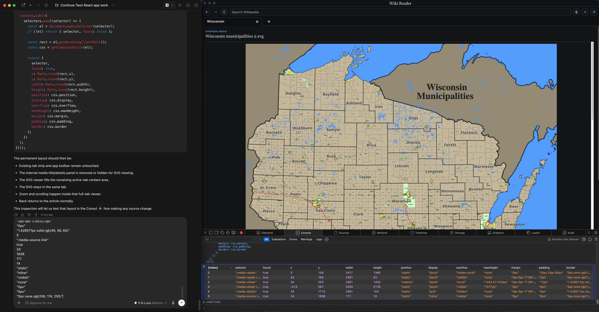

第三方截图 · 2026-07-29 · Wikideas1 · CC0。左侧是 Codex，会话内容与右侧独立 Wiki Reader / DOM 检查器并置；右侧不是 Codex 内置浏览器。 见 [S22]。

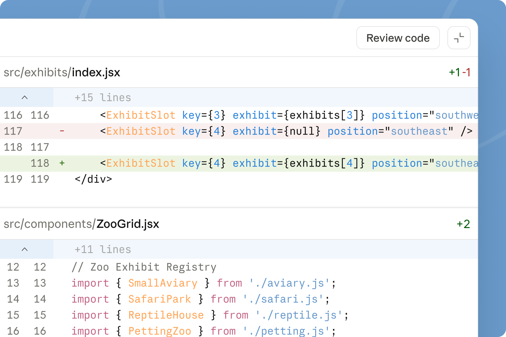

官方文章配图 · 2026-02-20。文件级改动和 Review code 同处审阅区；观察反馈入口的位置和代码密度。 见 [S21]。

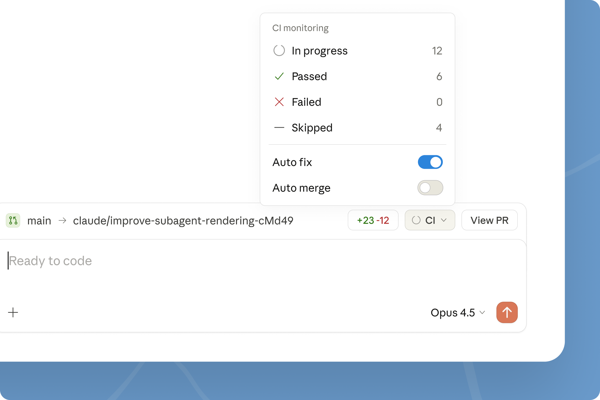

官方文章配图 · 2026-02-20。CI 进度可展开；Auto fix 和 Auto merge 分别设置，不能合并为一个“全部自动”。 见 [S21]。

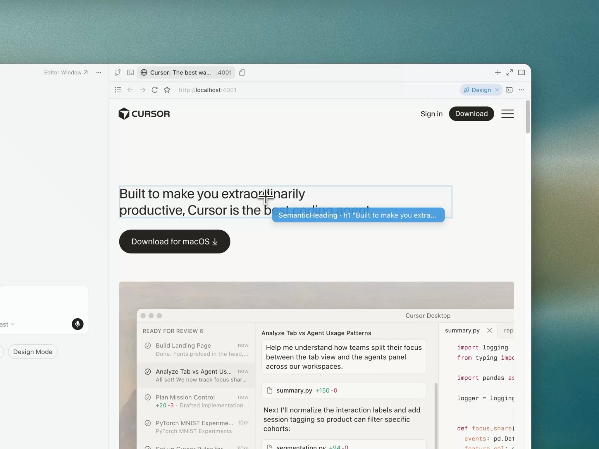

官方演示静帧 · 00:04。可见 Design 状态、标题轮廓和 SemanticHeading / h1 元素标签；不据单帧判断完整操作序列。 见 [S10]。

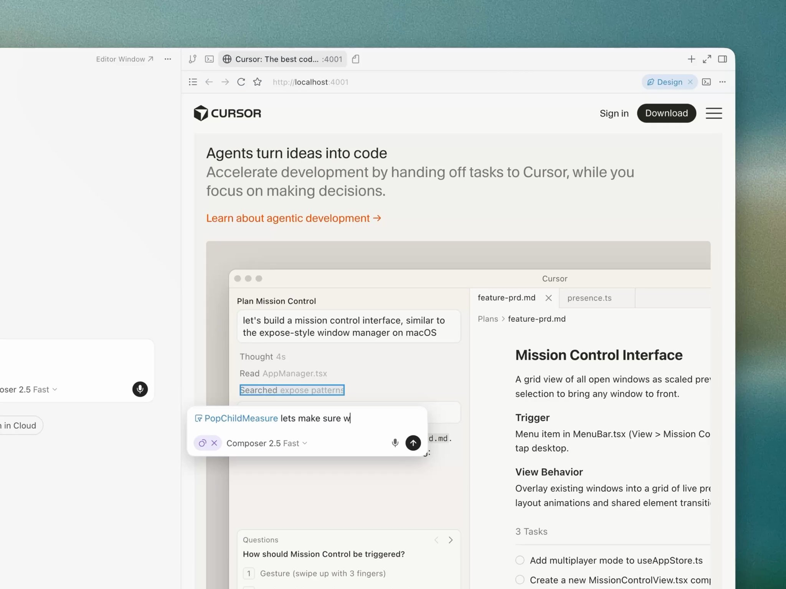

官方演示静帧 · 00:04。选中的页面内容附近出现带对象名、文本输入和发送动作的浮层；需核查手指遮挡与软键盘。 见 [S10]。

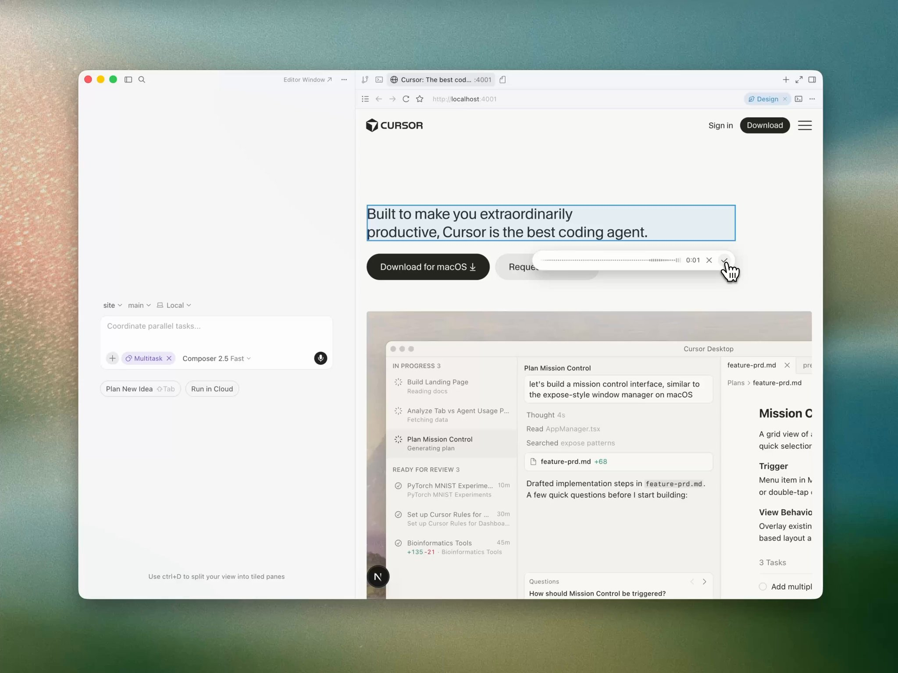

官方演示静帧 · 00:04。标题高亮与录音波形、取消和确认同屏；仅观察该帧，不推测识别准确度。 见 [S10]。

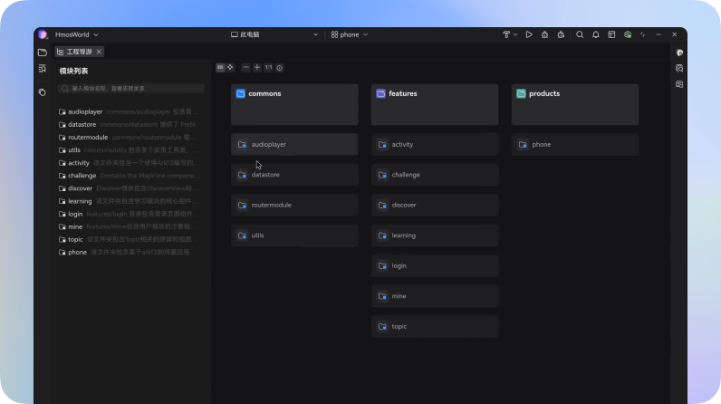

官方预览版配图 · 版本以原页为准。左侧工程模块列表、中央模块拓扑对应；支持分析复杂对象的选择层级，不代表已经提供触控委派。 见 [S19]。

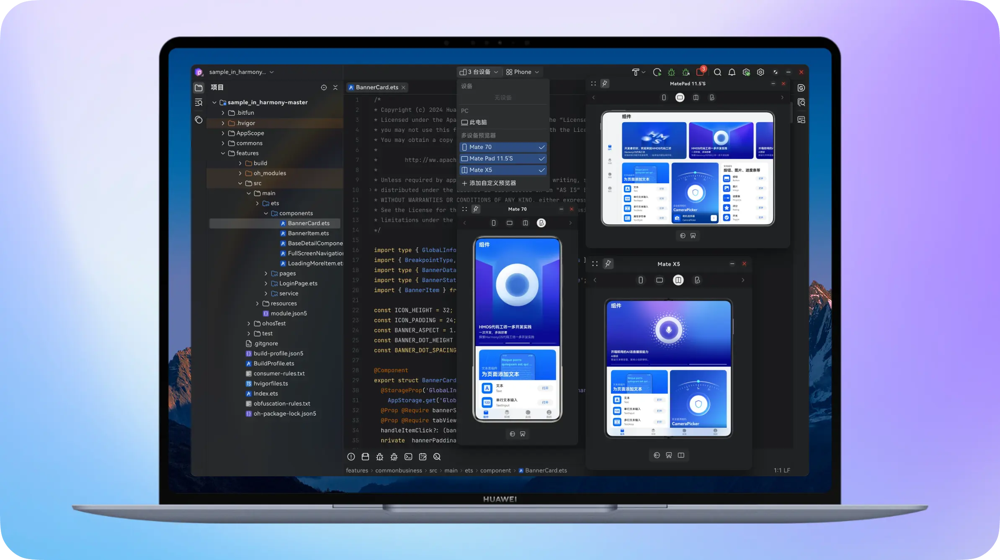

官方预览版配图 · 版本以原页为准。可见源码、三台已选择设备与多设备运行画面；设备身份、窗口和代码竞争同一工作区。 见 [S19]。

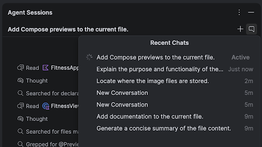

官方文档配图。Recent Chats 显示多个会话及 Active 状态；切任务时需要保留对象和设备上下文。 见 [S13]。

<!-- GALLERY_END -->

## 05 · 一条开发任务的体验旅程

场景：在鸿蒙触屏电脑上修改商品卡片布局，交给 Agent 实现，再在运行应用中检查和接管。以下是用于设计评审的任务模型，不是用户观察记录。旅程仅分析这一场景；跨产品对照放在下一章。

| 旅程行 | 找到对象 | 表达修改 | Agent 执行 | 审阅决定 | 验证与继续 |
|---|---|---|---|---|---|
| 用户行为 | 打开预览，切到选择模式，点中卡片 | 核对组件与设备，说明目标和范围，发送 | 查看进度；必要时暂停、改指令或接手 | 查看分组改动、批注，局部接受或回退 | 切到运行模式，在对应设备检查，补充反馈 |
| 关键触点 | T1 对象选择 | T2 上下文卡 / 输入 | T3 状态与接管 | T4 diff / 反馈入口 | T5 设备画面 / T6 姿态变化 |
| 情绪证据 | 未采集 | 未采集 | 未采集 | 未采集 | 未采集 |
| 摩擦与机会 | 触点小、点到父组件 → 层级选择与目标确认 | 只发截图难定位、键盘遮挡 → 对象绑定与可见发送 | 执行归属不清 → 显示设备占用与暂停原因 | hover 不可发现、误批 → 常驻反馈与按项决定 | 手势被画布拦截、折叠后定位丢失 → 模式路由和任务连续性 |

没有访谈或行为数据，故不绘制情绪数值曲线。后续观察应优先验证“找对象”和“审阅决定”两段是否出现挫败，而不是预设用户一定喜欢触屏。

### 无 Agent、单 Agent、多 Agent 的变化

| 同一任务 | 无 Agent | 单 Agent | 多 Agent |
|---|---|---|---|
| 修改界面 | 手动定位代码与调整参数 | 选对象、说目标、检查改动 | 每个目标要有任务与 Agent 归属，避免批注串到其他任务 |
| 操作运行应用 | 人工自由操作 | 人与 Agent 需要显式交接 | 设备占用和排队可见；接管只影响相关任务 |
| 审阅结果 | 检查自己的修改 | 按意图与风险检查 Agent 修改 | 区分作者、改动范围和验证设备；不能一次批准混合来源改动 |
| 切换折叠姿态 | 保留编辑位置 | 同时保留任务、对象、待决状态 | 当前任务优先可见，后台任务保持状态；避免每个任务都抢布局 |

## 06 · 三个关键触点深挖

### T1 / T2 · 选对象，再表达意图

| 比较维度 | Cursor — 元素与区域批注 | Claude Code 桌面 — 浏览器选元素 | Android Studio — 图片输入 |
|---|---|---|---|
| 结构示意（非产品截图） | 运行页面 → Annotate → 点选/圈画 → 批注 → 发送 | 预览 → 选元素 → 与任务交流 → 代码迭代 | 附加图片 → 描述目标 → 建议或代码修改 |
| 核心机制 | 元素信息和截图共同进入上下文；支持语音说明。见 [S10] | 浏览器选元素入口与桌面开发会话结合。见 [S08] | 视觉输入帮助模型理解外观与 UI 目标。见 [S14] |
| 优势（分析） | 目标具体；可积累一轮改动再发送 | 结果与对话相邻；可继续预览验证 | 图片来源灵活；不依赖 Web DOM |
| 约束 / 待验证 | 需管理圈画与滚动；无键盘多选和层级切换待验证 | 触控入口发现待验证；Web 元素上下文不能直接套用 ArkUI | 图片缺少天然的组件身份；旧图可能与当前运行状态不一致 |
| 对 DevEco 的借鉴 | 点选组件与圈画区域提供不同精度；批注发送状态可见 | 选择结果回到当前开发任务，并保留可见预览 | 支持截图反馈，同时补上设备、组件和采集时刻 |

**核心张力：指向越直接，模式冲突与上下文校验越重要。** 设计建议：运行应用时点按照常触发应用行为；只有进入“选组件 / 圈画问题”模式，点按才成为 Agent 上下文。对象卡至少显示组件、设备、文件及截图时间；对象不明确时，先选择层级再发。

Cursor 的 2025 年 Visual Editor 说明用于历史基线；当前 Annotate、语音批注、批量发送等细节以现行 Design Mode 文档为准。见 [S11]、[S10]。

### T3 / T4 · 反馈、批准与接手

| 比较维度 | Codex — 行级反馈 | Claude Code — 权限与 diff | Android Studio — 提议修改与等待 |
|---|---|---|---|
| 结构示意（非产品截图） | diff → 行评论 → 明确后续指令 → 修改 | 权限模式 → 操作/修改 → 审阅 → 接受或继续 | 提议改动 → Accept / Reject → 继续；Stop 独立 |
| 核心机制 | 精确到改动位置，支持不同范围的暂存与回退。见 [S06] | 执行自主程度和人工决定分开管理。见 [S08] | 官方配图将改动内容、决定按钮和等待状态串联。见 [S13] |
| 优势（分析） | 反馈位置精确；局部处理改动 | 执行边界可表达；审阅与验证可往返 | 等待原因可见；接受与停止语义分开 |
| 约束 / 待验证 | 文档中的 hover 加号与 Command 路径需触屏替代；拖选容易与滚动竞争 | 不同权限模式下的暂停含义需说明；CLI/桌面触控不能混评 | Auto-Approve 与逐项批准含义需区分；软键盘出现后的可达性待验证 |
| 对 DevEco 的借鉴 | 行/区块反馈常驻入口、局部回退、精确绑定 | 将“允许执行什么”与“认可什么结果”分开 | 可见的“在等你”，显示影响范围，并保留停止/接手 |

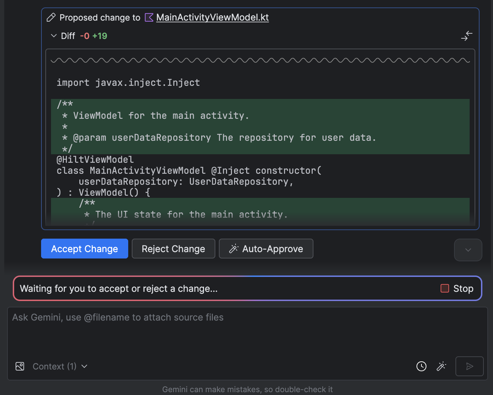

图像来源：[Android Studio Agent Mode][S13]，通过官方中国站同路径取得。图中可见 diff、Accept Change、Reject Change、Auto-Approve、等待条和 Stop。图片像素不能用于推定按钮实际逻辑尺寸；该图不证明触屏操作质量。

**核心张力：快捷决定与充分理解的平衡。** 设计建议：先呈现改动目的、影响对象与验证证据，再允许展开源码；高影响动作保留明确确认。单指滚动、文本选择、打开批注应有可发现的区别；回退要能追到具体任务与改动版本。

### T5 / T6 · 操作应用、调试与折叠

| 比较维度 | Android Studio — 运行设备 | Xcode — Preview / Device Hub | DevEco 鸿蒙版 — 设计候选 |
|---|---|---|---|
| 结构示意（非产品截图） | Agent → 部署 / adb → 设备画面与日志 | 源码 ↔ 预览；设备列表 → 画面 → 环境配置 | 当前任务 ↔ 组件 / 设备 → 人工或 Agent 操作 |
| 核心机制 | Agent 可部署、观察、截图和输入；官方列出嵌入窗口多指限制。见 [S13]、[S16] | 预览选择关联源码，Device Hub 管理设备。见 [S17] | 在已有多设备预览与 Agent 基础上定义输入归属。基线见 [S18] |
| 优势（分析） | 操作与日志证据相接；构建到设备形成闭环 | 对象与源码对应；设备身份同屏 | 可围绕鸿蒙多形态与 ArkUI 绑定任务；可与本机开发结合 |
| 约束 / 待验证 | 嵌入和独立窗口行为不同；手动与 adb 输入并发需测试 | 运行/选择模式需区分；触控透传质量未验证 | 姿态/软键盘适配和操作锁现状未核查；建议需架构和设备验证 |
| 对 DevEco 的借鉴 | 测试必须覆盖整条事件路径，不能只测屏幕响应 | 保持设备身份、运行状态、组件位置关联 | 人工接管后暂停相关 Agent 输入，姿态变化后刷新截图和坐标 |

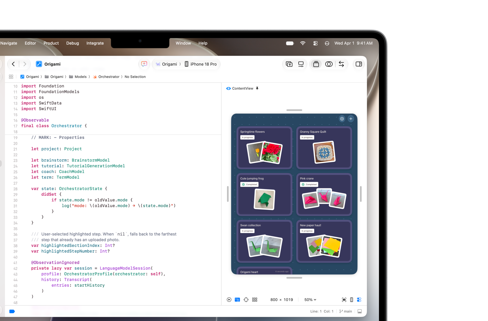

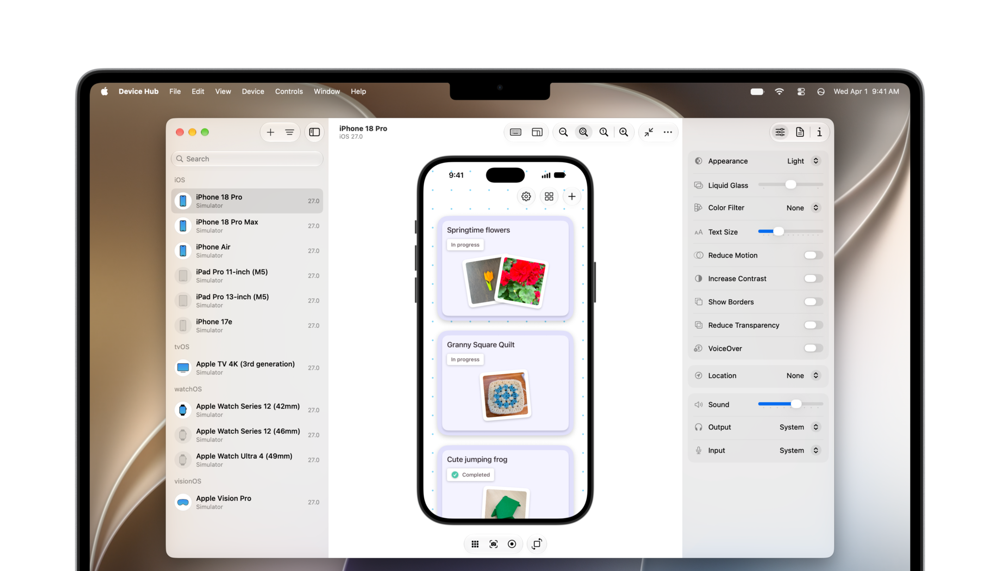

以上两图来自 [Xcode 官网][S17]：一张展示代码与预览并排，另一张展示设备列表、画面与设置。它们支持界面结构分析，不证明新 MacBook 上的实际触控手感或完整手势透传。

**核心张力：同一块画面既是运行对象，也是编辑和自动化的入口。** 人的捏合可能是在缩放画布，也可能是在测试应用；Agent 的输入可能与人的操作冲突。建议界面持续显示模式和操作归属，在真实输入链路上验证路由，不能只靠视觉上的按钮切换。

### 手势逐项拆解

| 输入动作 | 可能的冲突 | 鸿蒙版 DevEco 的候选规则 |
|---|---|---|
| 单指点按 | 运行应用 vs 选择组件 | 显式切换“运行 / 选组件”；选中后展示对象身份 |
| 单指拖动 | 滚动、选字、拖布局、圈画 | 默认遵循当前视图；圈画或布局调整需进入工具模式 |
| 双指捏合 / 平移 | 画布缩放 vs 应用内手势 | 运行模式传给应用，编辑模式控制画布；实际透传按实现复核 |
| 长按 | 文本选择、菜单、批注 | 提供可见批注入口，长按只作补充；避免唯一入口藏在长按里 |
| 手写笔 | 标注、文本、运行应用 | 按实际设备和笔支持范围启用标注；不推定 MacBook 支持笔 |
| 语音 + 点选 | “这个”指向过期或别的设备 | 录音前固定目标卡，发送前可核对组件和设备 |
| 软键盘弹出 | 输入框、发送、暂停和证据被遮挡 | 响应可见区变化，关键决定与停止/接手保持可达 |
| 折叠、旋转、接键盘 | 对象丢失、坐标漂移、布局跳动 | 保留任务和语义对象；刷新截图坐标，恢复设备相关布局 |

## 07 · 各家的取舍与机会

以下 SWOT 为基于公开路径的设计判断。约束不等于已复现的缺陷；机会与风险用于我方设计决策，不是市场预测。

| 产品 | 优势 S | 约束 W | 可借鉴机会 O | 对我方的风险 T |
|---|---|---|---|---|
| Codex | 行级反馈与局部改动处理；另有远程任务入口 | 桌面反馈流程包含 hover / 修饰键路径；触屏质量未知 | 让轻量触屏入口承担待决与结果审阅 | 只做大输入框而没有精确反馈，会弱化复杂工程审阅能力。见 [S06]、[S07] |
| Claude Code | 桌面预览、diff 与本地任务接续 | 终端、桌面与 SSH 会话能力不同 | 将任务、预览和审阅连成往返流程 | 只移植聊天会丢掉运行验证与执行边界。见 [S08]、[S09] |
| Cursor | 对象/区域批注、圈画、语音及批量发送 | Web 结构信息与 ArkUI 不同；快捷多选需替代 | 让视觉对象成为工程上下文 | 只传截图，目标定位仍依赖模型猜测。见 [S10]、[S12] |
| Android Studio | Agent 连接构建、部署、画面与日志 | 嵌入模拟器有公开多指限制 | 把触控问题变成可复现的设备证据 | 只验预览而不验输入链路，可能掩盖交互缺陷。见 [S13]、[S16] |
| Xcode | 预览对象对应源码；集中设备管理 | 模式差异与真实触控质量仍需验证 | 从预览对象直接进入修改与验证 | 多设备画面若没有身份和状态，会产生错误目标操作。见 [S17] |
| DevEco 鸿蒙版 | 官方已有本机 IDE、Agent 与多设备能力 | 触屏、姿态与人机并发的具体行为未实测 | 在 ArkUI、鸿蒙设备和折叠形态间建立同一任务上下文 | 若沿用密集桌面入口，硬件触屏可能难转化为任务收益。见 [S18]、[S19] |

## 08 · 鸿蒙版 DevEco Studio 的设计机会点

下列均为**待验证设计候选**。官方已有能力作为起点，具体是否已提供相似交互需产品团队或实机复核；优先级表示本次研究建议，不代表既定排期。

### P0-1 · 常驻的触控反馈与接管入口

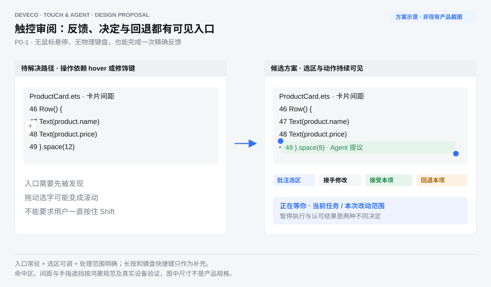

设计方案示意，非现有产品截图；窄屏可点击原图放大。

**场景：**没有鼠标和物理键盘，开发者要批注某处改动、拒绝一项修改或停止当前任务。

**依据：**Codex 的精确行反馈、Android Studio 的可见等待状态，以及 Microsoft 对触控目标的建议。见 [S06]、[S13]、[S05]。

**设计：**在改动卡或选区旁持续提供“批注 / 接手”；任务状态区显示“暂停”及所影响的任务；局部接受、回退有清晰范围。保留键鼠快捷操作，同时提供无修饰键的选区与多选控件。尺寸与间距按鸿蒙规范和设备逻辑坐标确定，Windows 44 epx 只作外部参照。

**依赖与验证：**依赖触控命中区、编辑器选区与任务停止状态联动。断开键盘完成批注、局部拒绝与回退；记录入口发现率、误触率、决定后恢复成功率；单独检查暂停是否真实生效。

### P0-2 · 软键盘出现后，任务与决定仍然看得见

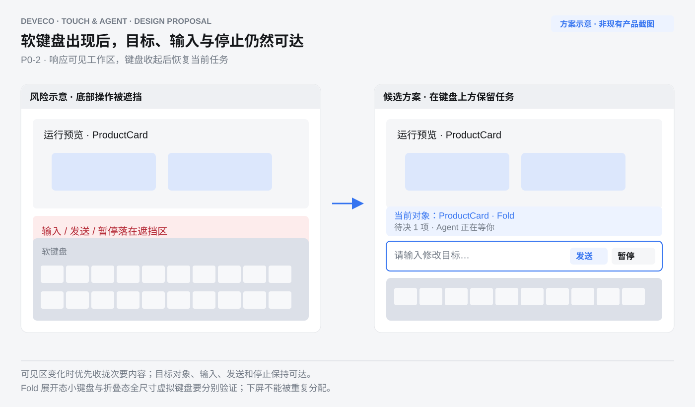

设计方案示意，非现有产品截图；窄屏可点击原图放大。

**场景：**在预览旁给 Agent 发消息，或者折叠态使用虚拟键盘。

**依据：**Fold 展开态与折叠态的输入方式不同。见 [S03]、[S04]。因此需要在实际可见区中安排内容，这是从系统输入行为推导的布局要求。

**设计：**根据窗口与可见区变化收拢次要面板；保留目标对象卡、输入、发送和停止；键盘收起后回到原任务和预览位置。由用户选择“跟随姿态 / 保持布局”，避免切换输入设备就反复重排整个 IDE。

**依赖与验证：**依赖系统可见区/键盘通知及面板恢复。覆盖普通触屏、Fold 展开小键盘、折叠虚拟键盘和外接键盘；检查控件遮挡、任务滚动位置丢失及布局往返是否稳定。

### P1-1 · 点选 ArkUI 组件，把对象与目标一起交给 Agent

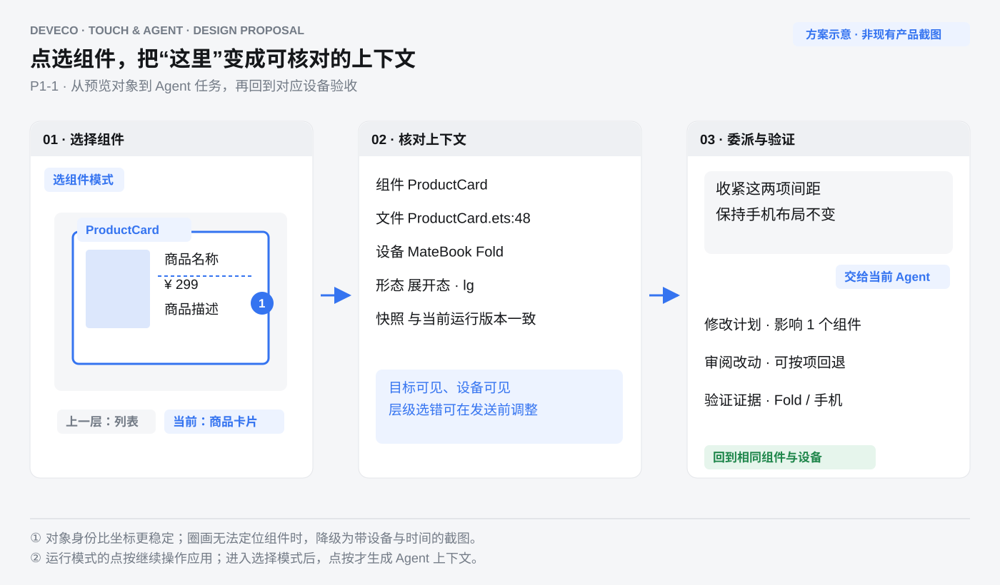

设计方案示意，非现有产品截图；窄屏可点击原图放大。

**场景：**点中商品卡片，说“收紧这两项间距，保持手机布局不变”。

**依据：**Codex 的浏览器元素/区域批注、Cursor 的对象上下文、Claude Code 预览选元素和 Xcode 预览到源码对应。见 [S20]、[S10]、[S08]、[S17]。

**设计：**进入选组件模式，显示可调层级的高亮；对象卡携带组件名、源码位置、设备、状态和采集版本。可圈画一个问题区域、语音说明，再明确发送范围。发出后该批注回到当前任务；无法定位组件时降级为带设备和时间的截图反馈。

**依赖与验证：**依赖 ArkUI 运行/预览树与源码映射，不能只传屏幕坐标。对比“文字描述 / 截图 / 点选”完成同一改动的澄清次数、错选组件率和完成时间；分别测父子层级相邻、重复组件和跨设备同名组件。

### P1-2 · “运行 / 选组件 / 圈画”模式与手势归属可见

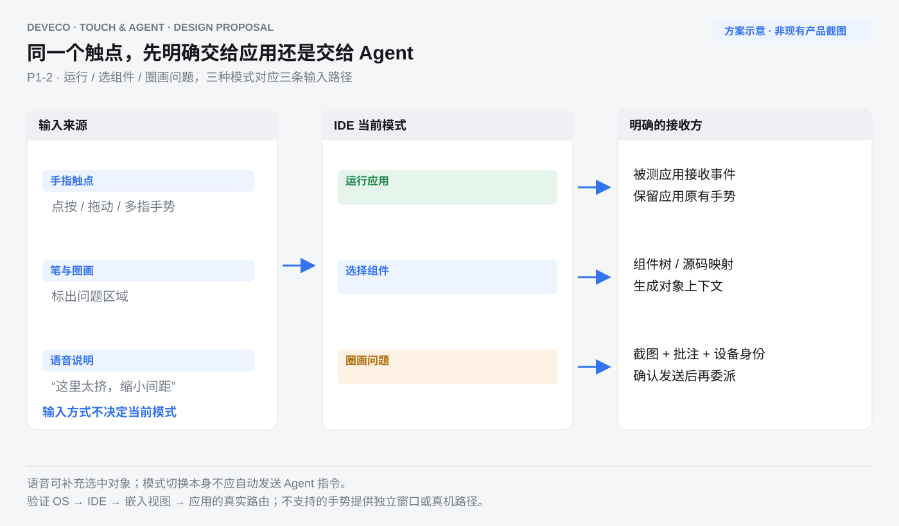

设计方案示意，非现有产品截图；窄屏可点击原图放大。

**场景：**一会儿滑动商品列表检验体验，一会儿圈出错误区域让 Agent 修复。

**依据：**Android Emulator 的嵌入多指限制与 Xcode 的不同预览模式，说明输入路径必须单独设计。见 [S16]、[S17]。

**设计：**明确显示当前模式；运行时把受支持的手势交给被测应用，选择时显示对象轮廓，圈画时留下批注。提供退出与取消，不让模式切换悄悄发送任务。若当前宿主/嵌入组件不能透传，提供独立窗口或真机路径并说明原因。

**依赖与验证：**依赖 OS → IDE → 嵌入视图 → 被测应用的输入路由。验证单击、双击、拖动、长按、捏合与双指平移；观察事件实际到达哪一层，记录丢触点、误派任务和模式误判。

### P1-3 · 设备操作有归属，人拿回控制后 Agent 停在原处

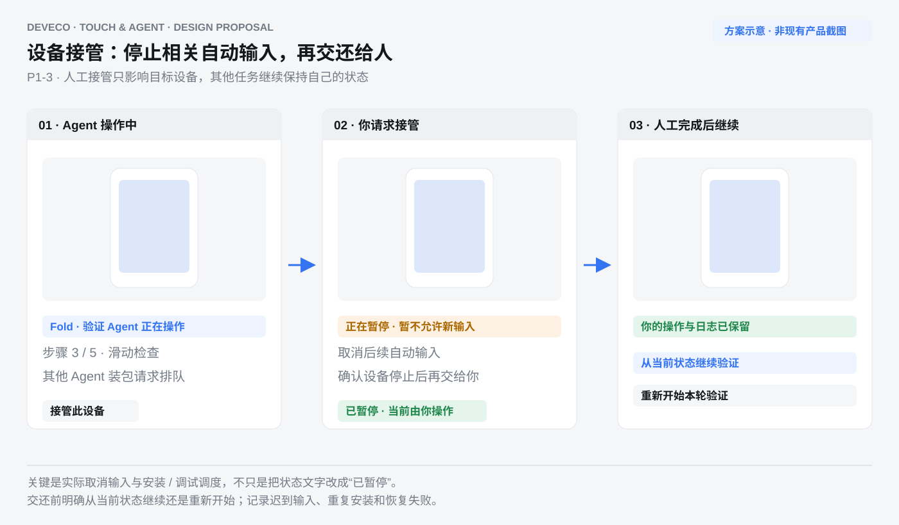

设计方案示意，非现有产品截图；窄屏可点击原图放大。

**场景：**Agent 在模拟器执行验证，开发者点入设备画面准备手动复现；另一个 Agent 同时想安装新包。

**依据：**Android Studio Agent 可以在设备上部署、观察和输入；Xcode 将设备身份与画面关联展示。见 [S13]、[S17]。操作归属方案是由此推导的设计建议，未声称竞品已有同样操作锁。

**设计：**设备卡显示谁在操作及当前步骤；点“接管”先停止该设备后续自动输入，再允许人工操作。保留已收集的日志和截图；继续时可选择“从当前状态验证 / 重新开始”。其他 Agent 占用同设备时进入排队或冲突决定。

**依赖与验证：**依赖设备任务调度、输入取消、安装与调试会话互斥。执行中接管并交还，检查是否还有迟到输入、重复装包或错误恢复；统计冲突发生和从接管到继续所需步骤。

### P2-1 · Fold 围绕当前任务展开，保留跨姿态上下文

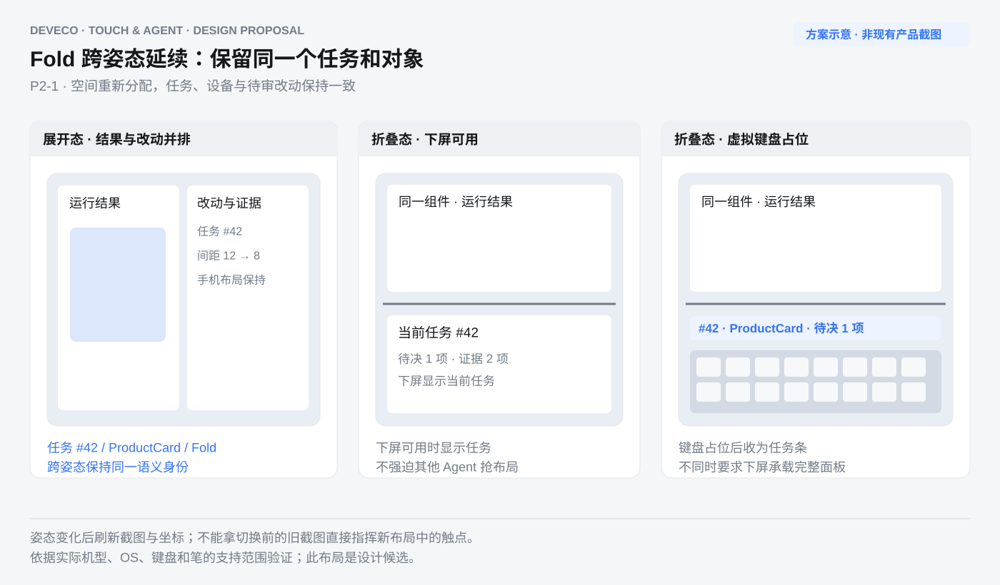

设计方案示意，非现有产品截图；窄屏可点击原图放大。

**场景：**展开屏查看代码和结果，折叠后用键盘继续指挥 Agent，再换到触控审阅。

**依据：**Fold 的旋转与输入形态变化。见 [S02]、[S03]、[S04]。这是设备特有候选，需要先证明基础任务收益。

**设计：**展开态允许结果与改动并排；折叠且下屏未被键盘占用时，可把当前任务、待决和证据放在下屏；虚拟键盘占位后收为紧凑任务条。保留任务 ID、组件语义身份、设备和待审改动；重新获取截图与坐标，不沿用切换前的旧截图定位。

**依赖与验证：**依赖可靠的姿态/窗口信息、布局状态与对象映射。覆盖执行中折叠、输入中旋转、审阅中接外接键盘；记录恢复时间、上下文丢失、错误坐标及布局手动调整次数。

### 建议落地顺序与现有方案衔接

| 阶段 / 优先级 | 先交付什么 | 负责能力（建议） | 观测指标 | 可衔接的现有方案 |
|---|---|---|---|---|
| 第一阶段 · P0 | 无 hover 的反馈、暂停/接手，软键盘可见区与布局恢复 | IDE 框架、编辑器、Agent 任务状态 | 无键盘完成率、误触、遮挡、恢复成功率 | Agent 工作台、意图确认、结论先行 |
| 第二阶段 · P1 | 对象卡与点选委派；运行/选择模式；设备接管与冲突处理 | 预览树/源码映射、Agent 上下文、设备调度 | 错选、澄清、模式误判、迟到输入 | D2C / 预览写回、语音开发、多设备验证 |
| 第三阶段 · P2 | Fold 按姿态呈现当前任务，并延续多 Agent 状态 | 窗口/姿态服务、任务状态存储 | 切换恢复、上下文丢失、布局调整次数 | 折叠屏开发、多 Agent 工作台 |

### 如何验证收益

使用相同工程和六条任务比较键鼠基线与触控候选：选中并修改重复组件；批注一段 diff；接受部分改动并回退一项；手动捏合/平移检查应用；接管 Agent 正在使用的设备；执行中折叠并恢复。

设备组合至少包括普通触屏加物理键盘、无物理键盘状态、Fold 展开与折叠、嵌入与独立模拟器；记录 OS、IDE、Agent、模拟器版本与屏幕缩放。先用真实用户观察建立基线，再确定提升目标，不预设“效率提高百分之多少”。

**准出建议：**每项关键决定在无 hover 和无物理键盘时可完成；人工接管后没有迟到的自动输入；姿态变化后对象和设备归属不丢失；运行手势与委派手势不会互相误触发；每条“验证通过”能追到具体设备、状态与证据。以上是设计验证准则，不代表现有产品已经满足。

## 09 · 来源、证据与待核查项

**研究限制：**未进行触屏设备实测，未采集用户访谈与使用数据。现阶段可比较的是官方能力、公开路径与候选设计；触控体验质量与效率需后续验证。官网内容可能更新，记录以 2026-11-03 的公开页面为基线。

**图像边界：**已补齐六款工具的界面结构参考。Codex 为第三方历史截图，其余为官方配图或官方演示静帧。仍缺各工具在触屏设备上的实机操作图；配图不能证明触控质量。六张设计方案示意与截图分开标识。被排除的片头人物画面、无关图标和未呈现关键交互的候选不计入证据。

**待核查：**各工具在相应系统的安装与账户可用性；鸿蒙版 DevEco 当前已实现的触控细节；MacBook 新机及各版本 IDE 的触控行为；Fold 代际、系统与笔的兼容；软键盘、输入路由、远程延迟和人机并发操作。

S01—S21 为官方能力来源，S22 为公开截图来源。第三方截图仅作界面结构观察，能力以官方文档为准；来源等级不代表已实测触控质量。

<!-- SOURCES -->

- **S01** · [Apple · 触屏 MacBook Pro 发布](https://images.apple.com/newsroom/2026/10/apple-unveils-groundbreaking-macbook-pro-with-proled-xdr-display/) · 官方 A · 核查：2026-11-03
- **S02** · [华为 · MateBook Fold 产品页](https://consumer.huawei.com/cn/harmonyos-computer/matebook-fold-ultimate-design/) · 官方 A · 核查：2026-11-03
- **S03** · [华为 · Fold 展开态使用](https://consumer.huawei.com/cn/support/content/zh-cn16048766/) · 官方 A · 核查：2026-11-03
- **S04** · [华为 · Fold 虚拟键盘](https://consumer.huawei.com/cn/support/content/zh-cn16050601/) · 官方 A · 核查：2026-11-03
- **S05** · [Microsoft · Touch interactions](https://learn.microsoft.com/en-us/windows/apps/develop/input/touch-interactions) · 官方 A · 核查：2026-11-03
- **S06** · [OpenAI · Code review](https://learn.chatgpt.com/docs/code-review?surface=app) · 官方 A · 核查：2026-11-03
- **S07** · [OpenAI · Codex on mobile](https://learn.chatgpt.com/docs/mobile) · 官方 A · 核查：2026-11-03
- **S08** · [Anthropic · Claude Code Desktop](https://code.claude.com/docs/en/desktop) · 官方 A · 核查：2026-11-03
- **S09** · [Anthropic · Remote Control](https://code.claude.com/docs/en/remote-control) · 官方 A · 核查：2026-11-03
- **S10** · [Cursor · Design Mode](https://cursor.com/docs/agent/design-mode) · 官方 A · 核查：2026-11-03
- **S11** · [Cursor · Visual editor 发布说明](https://cursor.com/blog/browser-visual-editor) · 官方 A · 核查：2026-11-03
- **S12** · [Cursor · Browser](https://cursor.com/docs/agent/tools/browser) · 官方 A · 核查：2026-11-03
- **S13** · [Google · Android Studio Agent Mode](https://developer.android.com/studio/gemini/agent-mode) · 官方 A · 核查：2026-11-03
- **S14** · [Google · Attach an image](https://developer.android.com/studio/gemini/attach-image) · 官方 A · 核查：2026-11-03
- **S15** · [Google · Android Emulator](https://developer.android.com/studio/run/emulator) · 官方 A · 核查：2026-11-03
- **S16** · [Google · Emulator known issues](https://developer.android.com/studio/run/emulator-troubleshooting) · 官方 A · 核查：2026-11-03
- **S17** · [Apple · Xcode](https://developer.apple.com/xcode/) · 官方 A · 核查：2026-11-03
- **S18** · [华为 · DevEco Studio](https://developer.huawei.com/consumer/cn/deveco-studio) · 官方 A · 核查：2026-11-03
- **S19** · [华为 · DevEco Studio Preview](https://developer.huawei.com/consumer/cn/deveco-studio/preview/) · 官方 A · 核查：2026-11-03
- **S20** · [OpenAI · Browser / Annotation](https://learn.chatgpt.com/docs/browser?surface=app) · 官方 A · 核查：2026-11-03
- **S21** · [Anthropic · Preview, review and merge](https://claude.com/resources/articles/preview-review-and-merge-with-claude-code) · 官方 A · 核查：2026-11-03
- **S22** · [Wikideas1 · Codex 公开截图（CC0）](https://commons.wikimedia.org/wiki/File:Screenshot_of_OpenAI_Codex.png) · 第三方图像 C · CC0 · 核查：2026-11-03

[S01]: https://images.apple.com/newsroom/2026/10/apple-unveils-groundbreaking-macbook-pro-with-proled-xdr-display/
[S02]: https://consumer.huawei.com/cn/harmonyos-computer/matebook-fold-ultimate-design/
[S03]: https://consumer.huawei.com/cn/support/content/zh-cn16048766/
[S04]: https://consumer.huawei.com/cn/support/content/zh-cn16050601/
[S05]: https://learn.microsoft.com/en-us/windows/apps/develop/input/touch-interactions
[S06]: https://learn.chatgpt.com/docs/code-review?surface=app
[S07]: https://learn.chatgpt.com/docs/mobile
[S08]: https://code.claude.com/docs/en/desktop
[S09]: https://code.claude.com/docs/en/remote-control
[S10]: https://cursor.com/docs/agent/design-mode
[S11]: https://cursor.com/blog/browser-visual-editor
[S12]: https://cursor.com/docs/agent/tools/browser
[S13]: https://developer.android.com/studio/gemini/agent-mode
[S14]: https://developer.android.com/studio/gemini/attach-image
[S15]: https://developer.android.com/studio/run/emulator
[S16]: https://developer.android.com/studio/run/emulator-troubleshooting
[S17]: https://developer.apple.com/xcode/
[S18]: https://developer.huawei.com/consumer/cn/deveco-studio
[S19]: https://developer.huawei.com/consumer/cn/deveco-studio/preview/
[S20]: https://learn.chatgpt.com/docs/browser?surface=app
[S21]: https://claude.com/resources/articles/preview-review-and-merge-with-claude-code
[S22]: https://commons.wikimedia.org/wiki/File:Screenshot_of_OpenAI_Codex.png
