# 触屏与触控笔，究竟改变了哪些 Agent / IDE 交互

分析日期：2026-11-03 · UX 视角 · v3 · 以键鼠为对照，重审触控增量

分析目标：比较 Codex、Claude / Claude Code、Cursor、Android Studio、Xcode 与鸿蒙版 DevEco Studio，识别手指、触控笔以及折叠姿态分别带来的约束与机会。保留已有截图，重新判断它们能证明什么。

证据口径：26 项官方来源、1 项第三方图像来源，12 幅界面图。正文的 6 张新示意针对输入差异重画；v1 / v2 和旧示意保留为历史。未进行触屏或笔实测，不提供体验排名或效率提升百分比。

## 01 · 先问：换回鼠标，这个机会还成立吗

**“点选对象交给 Agent”不是触控创新，“圈画批注”也不是笔独占。** Codex / Cursor 的视觉反馈、Claude Code 的预览反馈、Xcode 的组件选择，本身在键鼠环境就成立。它们能证明通用上下文能力，不能证明手指或笔创造了新的工作流。见 [S20]、[S10]、[S08]、[S17]。

这次将分析单位改成：**同一个任务，从键鼠换成手指或笔后，哪个输入条件变了，交互必须怎样改变，Agent 在其中具体补哪一步。** 能用鼠标原样完成的方案，不再以“触控创新”计入机会点。

| 判断类别 | 识别方法 | 例子 | 在报告中的位置 |
|---|---|---|---|
| 输入适配必需项 | 换输入后出现新的识别、命中或事件处理要求 | 手指遮挡；笔迹与手掌触点；笔擦除与手势取消 | 主体机会，但应称适配或输入设计，不能包装成全新 Agent 能力 |
| 可能降低成本的交互 | 原任务键鼠也能做，需要证明直触 / 用笔减少了什么成本 | 在预览上落笔批注，并口述目标 | 有条件探索；需与鼠标批注比较，不能先宣布更高效 |
| 设备形态带来的变化 | 即使不用触控也会发生 | Fold 折叠、旋转、下屏被键盘占用 | 单列形态因素，不归因于手指或笔 |
| 通用 Agent / IDE 基线 | 换回键鼠，问题和方案基本不变 | 任务队列、设备租约、按意图审阅、局部回退、对象身份 | 保留为基础设施，移出触控创新清单 |

**新的结论：优先解决手指的目标歧义、手势路由，以及笔的笔迹 / 触点判别与取消；再验证笔迹能否减少表达修改的成本。** “设备接管”和“按意图审阅”继续重要，但属于所有输入都需要的能力。

## 02 · 键鼠、手指、触控笔：不能混成一个输入类型

| 条件 | 键鼠 / 触控板基线 | 手指直接触屏 | 主动笔（有硬件支持时） | 对 IDE 的实际要求 |
|---|---|---|---|---|
| 目标与遮挡 | 光标指向，手通常不遮挡屏幕目标 | 接触面积与手部遮挡使密集目标需要消歧 | 笔尖较细，但握笔手仍可能遮住旁边浮层 | 手指候选目标 / 选区调整；浮层避开接触区，不能只换按钮样式 |
| 接触前反馈 | 可用光标悬停 | 常规手指直触没有可依赖的 hover | 部分主动笔提供接近 / 悬停；不保证每台机器都有 | 手指入口不依赖 hover；有笔悬停时可预高亮，无悬停时仍能完成操作 |
| 连续输入 | 鼠标拖动 / 触控板手势 | 多触点同时落在内容上，可能被系统、画布或应用消费 | 笔迹包含连续轨迹；压感 / 倾斜仅在支持时存在 | 保留输入来源和手势状态，不把所有移动事件都压成鼠标拖动 |
| 模式与取消 | 点选、拖动、右键也会冲突 | 滚动、框选、捏合、长按竞争 | 书写、圈选、擦除、手掌触点可能同时出现 | 显示当前工具；取消的触点 / 笔迹不能变成 Agent 命令 |
| 组合操作 | 物理键盘常与指针并用 | 有 / 无键盘须分开，不预设触屏就没有键盘 | 可能一手持笔、一手操作画布；也可能单手用笔 | 等效的可见控件；笔与手指协作是待验证方案，不是默认可行事实 |

平台依据见 [S24]、[S25]、[S26]、[S27]。**被动电容笔通常只是手指的替代，不应承诺主动笔的悬停、压感、笔键或防误触能力。** 主动笔也需要逐项核对硬件、驱动、系统和应用是否传递相应信息。

### 硬件范围与证据边界

| 对象 | 目前能确认什么 | 不应默认什么 |
|---|---|---|
| 新触屏 MacBook Pro | 发布资料描述触屏与键鼠配合；供货日期为 11 月 6 日，晚于研究日。见 [S01] | 本次未取得其支持触控笔的官方证据；不能将 Apple Pencil 或其他主动笔能力移植过来 |
| 鸿蒙 MateBook + M-Pen 3 | 官方兼容表按具体机型列出支持与版本条件；Fold 麒麟 X90 Plus、Pro S、14 鸿蒙版等需逐项核对。见 [S23] | “能书写”不等于所有机型都提供同样的笔悬停、笔键、擦除、压感或 IDE 接入 |
| Fold | 官方页说明手写及不同姿态；展开小键盘与折叠虚拟键盘不同。见 [S02]、[S03]、[S04] | 折叠是独立因素；下屏布局变化不能全部归功于触控或笔 |
| Windows / Android 平台资料 | 证明系统区分笔、触点、笔迹、取消等语义。见 [S24]—[S27] | 平台支持不代表 Codex、Cursor、Android Studio 或 DevEco 已接入这些能力；Android API 不是鸿蒙 API |

Agent 的入口、执行宿主、被测应用所在设备仍需分开。手机审批、远程会话和触屏电脑桌面不是同一种形态；跨生态工具的鸿蒙原生支持也不能推定。见 [S07]、[S09]、[S18]。

## 03 · 六款工具：基线能力与输入差异分开比较

| 工具 | 键鼠下已有的通用能力 | 换成手指后该核查什么 | 加入主动笔后该核查什么 | 现有证据能否证明触控 / 笔增量 |
|---|---|---|---|---|
| Codex | 元素 / 区域批注、diff 行反馈、局部改动处理。见 [S20]、[S06] | hover 加号的等效入口；区域拖选与滚动；手指遮住对象后的目标确认 | 笔是否只被当鼠标；笔迹能否保留及撤回；擦除是否会误发反馈 | 文档证明通用能力；现有历史截图不证明手指或笔操作 |
| Claude / Claude Code | 桌面预览反馈、diff 与验证；终端和远程形态另分。见 [S08]、[S09] | 弹层位置、目标命中和无 hover 路径；有无键盘分别测 | 连续落笔、手掌事件和笔输入焦点；手写文本与批注层是否冲突 | 配图证明审阅与 CI 结构，未证明触控笔适配 |
| Cursor | 元素、区域、语音批注与批量发送。见 [S10] | 手指拖动究竟是在滚动还是圈画；不用 Shift 的多选 | 圈线是普通拖动还是笔迹；书写 / 擦除如何切；单帧不能证明防误触 | 官方演示帧含鼠标光标；不是笔演示，不能因有圈画就宣称笔体验成熟 |
| Android Studio | Agent 构建、部署、截图、日志和设备输入。见 [S13] | 嵌入模拟器多指限制；独立窗口的实际输入路径。见 [S16] | 宿主笔事件是否到达被测应用；工具类型、压感、取消是否保留 | SDK 的笔能力属于目标平台；不能直接当作 Studio 宿主已有笔透传 |
| Xcode | 预览选择定位源码，交互预览和 Device Hub。见 [S17] | 捏合是在缩放画布还是测试应用；接触对象是否准确 | 先确认宿主支持笔；本次没有触屏 MacBook 笔支持证据 | 官网图证明预览结构，不能证明新增机型的实际手感 |
| 鸿蒙版 DevEco Studio | 官方已有 Agent、多设备预览、构建、调试和调优。见 [S18]、[S19] | ArkUI 密集组件命中、触点路由与实际窗口行为 | 按 M-Pen 3 机型和系统核查笔迹、悬停、擦除、防误触与工具切换 | 现有图为工程与多设备结构，输入质量仍需实机验证 |

这里不把“笔能力未找到文档”写成“不支持”。比较结果是一张验证清单，不是一份产品缺陷排名。

## 04 · 截图：它们证明的是哪一层

原有 12 幅界面图继续保留。它们主要证明通用 Agent 能力或 IDE 布局，**没有一张可以单凭画面证明触控笔适配或手指操作更高效**。Cursor 为官方短演示 00:04 静帧；Codex 是 CC0 第三方历史截图，右侧是独立应用与 DOM 检查器，不是 Codex 内置浏览器。

<!-- GALLERY_START -->

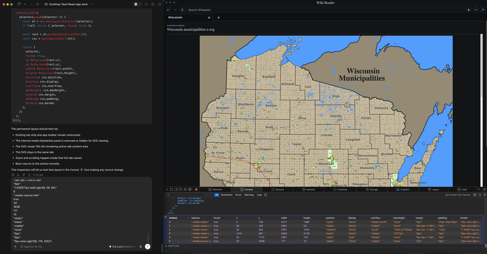

第三方截图 · 2026-07-29 · Wikideas1 · CC0。左侧是 Codex，会话内容与右侧独立 Wiki Reader / DOM 检查器并置；右侧不是 Codex 内置浏览器。 见 [S22]。

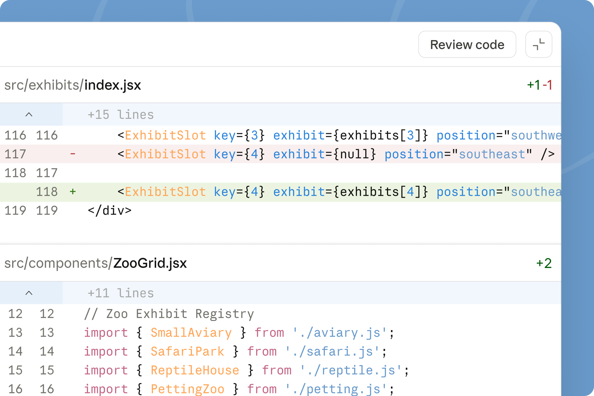

官方文章配图 · 2026-02-20。文件级改动和 Review code 同处审阅区；观察反馈入口的位置和代码密度。 见 [S21]。

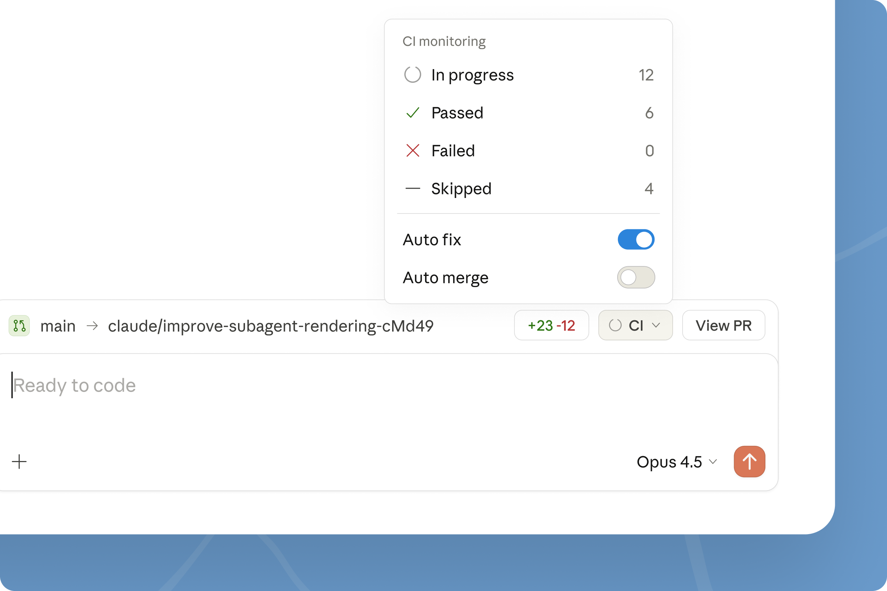

官方文章配图 · 2026-02-20。CI 进度可展开；Auto fix 和 Auto merge 分别设置，不能合并为一个“全部自动”。 见 [S21]。

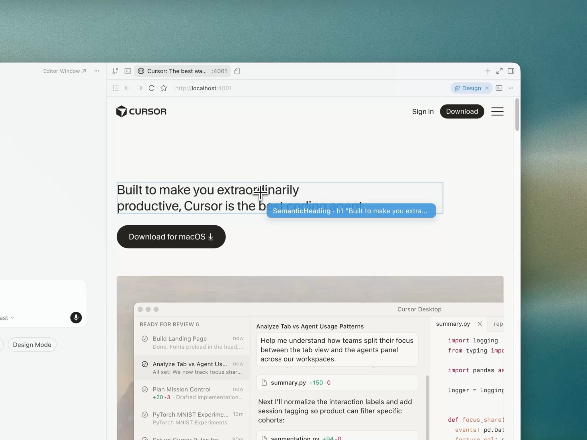

官方演示静帧 · 00:04。可见 Design 状态、标题轮廓和 SemanticHeading / h1 元素标签；不据单帧判断完整操作序列。 见 [S10]。

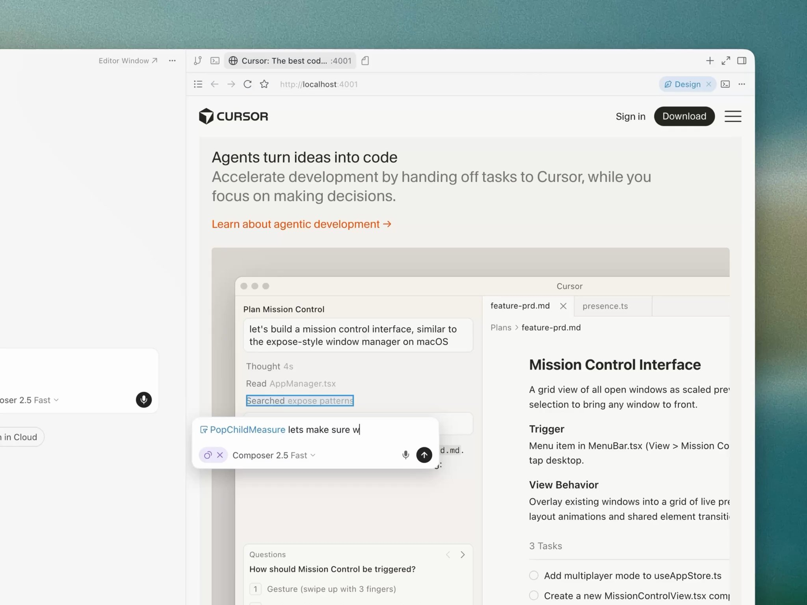

官方演示静帧 · 00:04。选中的页面内容附近出现带对象名、文本输入和发送动作的浮层；需核查手指遮挡与软键盘。 见 [S10]。

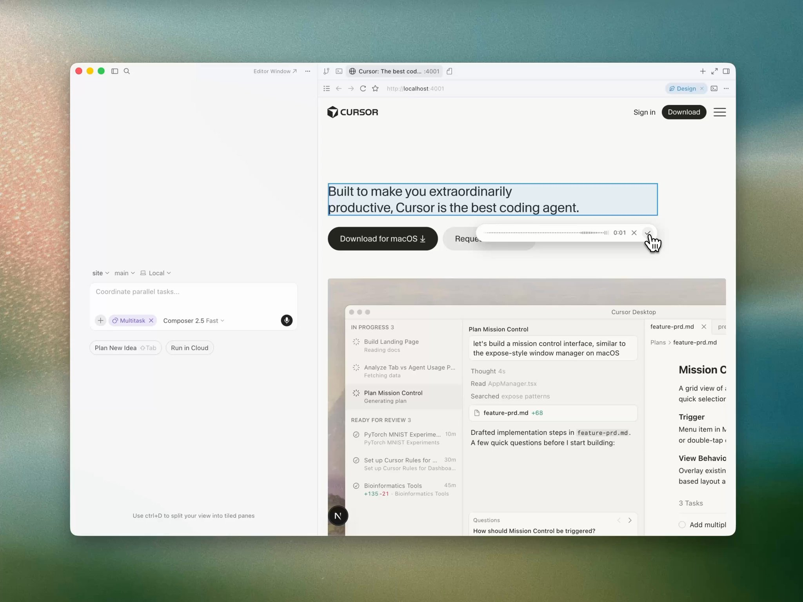

官方演示静帧 · 00:04。标题高亮与录音波形、取消和确认同屏；仅观察该帧，不推测识别准确度。 见 [S10]。

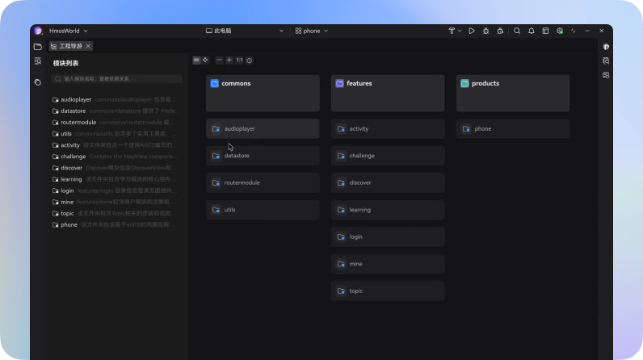

官方预览版配图 · 版本以原页为准。左侧工程模块列表、中央模块拓扑对应；支持分析复杂对象的选择层级，不代表已经提供触控委派。 见 [S19]。

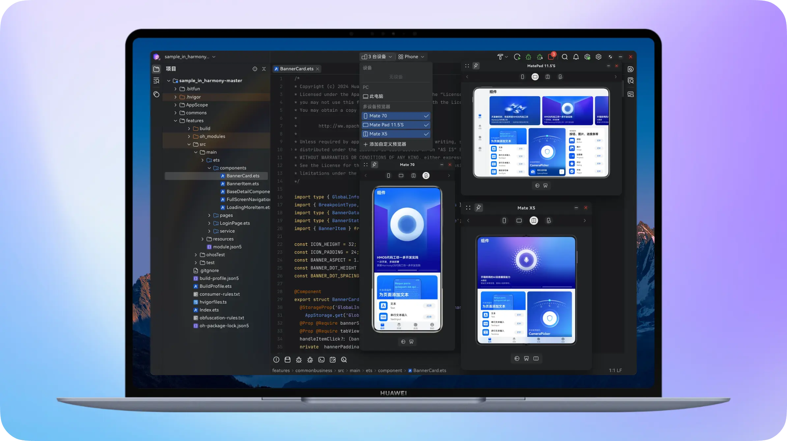

官方预览版配图 · 版本以原页为准。可见源码、三台已选择设备与多设备运行画面；设备身份、窗口和代码竞争同一工作区。 见 [S19]。

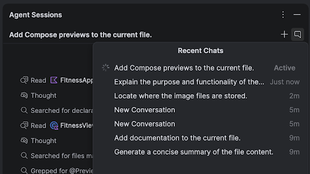

官方文档配图。Recent Chats 显示多个会话及 Active 状态；切任务时需要保留对象和设备上下文。 见 [S13]。

<!-- GALLERY_END -->

## 05 · 同一任务，三种输入到底差在哪里

任务：修改商品卡片间距，保持手机布局不变，再在运行应用中验证。目标、Agent、工程和验收要求相同，只改变输入方式；折叠和软键盘作为另外的条件记录。

| 旅程行 | 找到对象 | 表达修改 | Agent 处理 | 审阅 | 运行验证 |
|---|---|---|---|---|---|
| 用户行为 | 键鼠定位 / 手指接触 / 笔尖定位 | 键入说明 / 手指圈区 / 笔写箭头与数值 | 三条路径都交给同一 Agent | 三条路径都读改动与证据 | 分别用指针、真实手势与笔测试 |
| 关键触点 | 接触前后反馈、遮挡与消歧 | 拖动模式、笔迹归属与识别预览 | 输入未完成 / 已取消的状态 | 精确选择与入口发现 | 输入到达应用还是被画布拦截 |
| 情绪证据 | 未采集 | 未采集 | 未采集 | 未采集 | 未采集 |
| 真正的差异 / 不变量 | 手指需处理接触面积；笔可能有悬停 | 笔迹是新增数据类型；“让 Agent 改”仍是通用任务 | Agent 不应猜测被撤销的笔迹；任务队列是共同基线 | 按意图审阅是共同基线；选区与菜单需适配各输入 | 能点通界面不等于支持多触点、笔类型、压感和取消 |

**不能把“先写一段话”与“点一下组件”直接比耗时。** 应比较已经具备元素选择能力的鼠标路径，和完成同样范围选择的手指 / 笔路径。否则测到的是“有没有视觉上下文”，而不是“触控增加了什么”。

## 06 · 手指与笔的关键变化

### 手指：命中后确认，替代 hover 与精确光标

鼠标已经能点选组件。手指的新问题是接触位置和目标轮廓可能被手遮住，以及相邻 / 嵌套组件无法仅靠落点确定。设计候选是在接触后给出可核对的候选目标、层级切换和可调选区，浮层避开接触区域。是否更好要用错选和恢复成本验证。依据：[S05]、[S24]。

### 多触点：区分应用测试与 IDE 导航

鼠标滚轮和触控板也能缩放，因此“支持缩放”不算触屏新增价值。增量在于：手指直接落在预览上时，多触点和连续轨迹是否真实到达被测应用；运行、标注与画布导航有没有混淆。Android 官方嵌入模拟器限制提醒我们要检查整条链路。见 [S15]、[S16]。

### 笔：先保留笔迹，再决定其含义

笔写“8”、画箭头或删线，可能是说明、草图或希望修改的内容。圈线也能用鼠标画，所以差异不能仅写成“可以圈选”。真正需要设计的是笔迹的暂存、修改、擦除、与具体组件绑定，以及识别结果在提交给 Agent 前能否核对。Windows Ink 将笔迹、擦除、套索等分开处理；示例也可以接收鼠标，反而说明不能宣称圈画为笔独占。见 [S26]。

### 笔与手掌：输入可能先出现，再被取消

不能把“第一次收到触点”就等同于“用户确认发出命令”。Android 文档描述手掌触点可能先上报、随后取消；这提供了需要验证的事件状态模型。DevEco 应在鸿蒙实际输入框架上确认等效取消行为，不能套用 Android API 名称。防误触、笔手协作以及一手平移一手写，都要按设备实测。见 [S25]、[S27]。

### 笔悬停、笔键与压感：按支持能力增强，保留替代入口

手指的无 hover 问题不能推广到主动笔。若该机型提供笔悬停，可先预高亮对象；没有则在接触后确认。笔键 / 擦除端可作为工具切换补充，但没有按键也要能用可见菜单完成。压感或倾斜不能被随意解释成更高权限或确认强度；本次仅在需要真实笔迹 / 应用测试时记录它们。见 [S24]、[S25]、[S26]。

## 07 · 从触控创新清单退回通用基线的内容

| 原机会 | 为什么不能算触控增量 | 继续保留什么 | 真正需要补测的输入差异 |
|---|---|---|---|
| 点选组件交给 Agent | 鼠标下已有对应能力 | 组件身份、设备、代码位置和版本绑定 | 手指误选；笔迹绑定与撤回 |
| 按意图审阅、局部回退 | 键鼠和远程协作同样需要 | diff、证据、反馈范围与回退能力 | 手指 / 笔能否精确选中并批注 |
| 设备占用与人工接管 | 鼠标与 Agent 同时操作也会冲突 | 任务调度、互斥、取消与恢复 | 不将任意手掌触点当接管意图 |
| 多 Agent 待决队列 | 和输入方式没有必然关系 | 任务与责任归属 | 控件能否被当前输入发现和命中 |
| 语音指令 | 不需要触屏，普通电脑也能用 | 语音与任务上下文 | 用笔 / 手指指向与语音的关联是否减少澄清 |
| 软键盘与窄屏布局 | 属于输入 / 窗口适配，笔记本触屏也可能一直有键盘 | 可见区处理与位置恢复 | 不把“没有键盘”作为所有触屏任务的默认前提 |

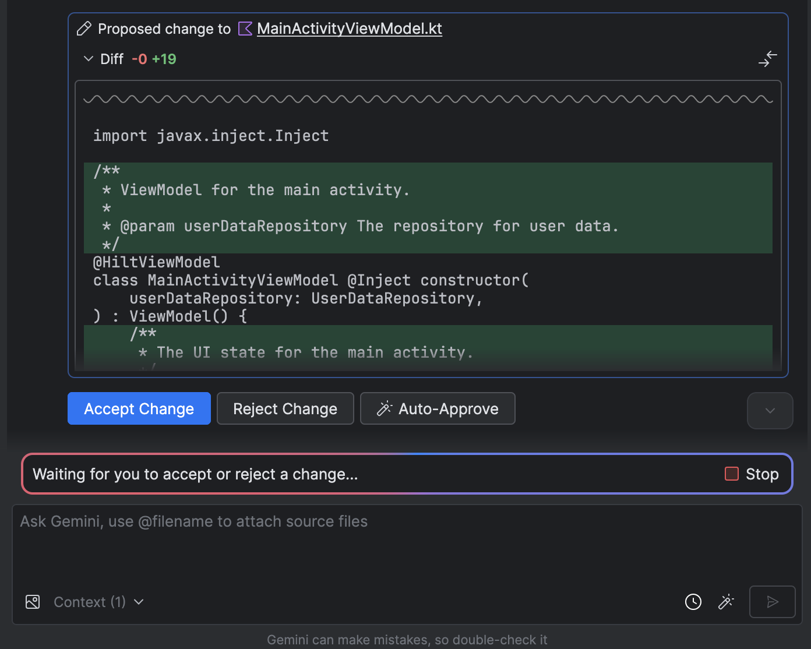

这张图证明审阅与等待状态的组织，不能证明手指操作质量。见 [S13]。

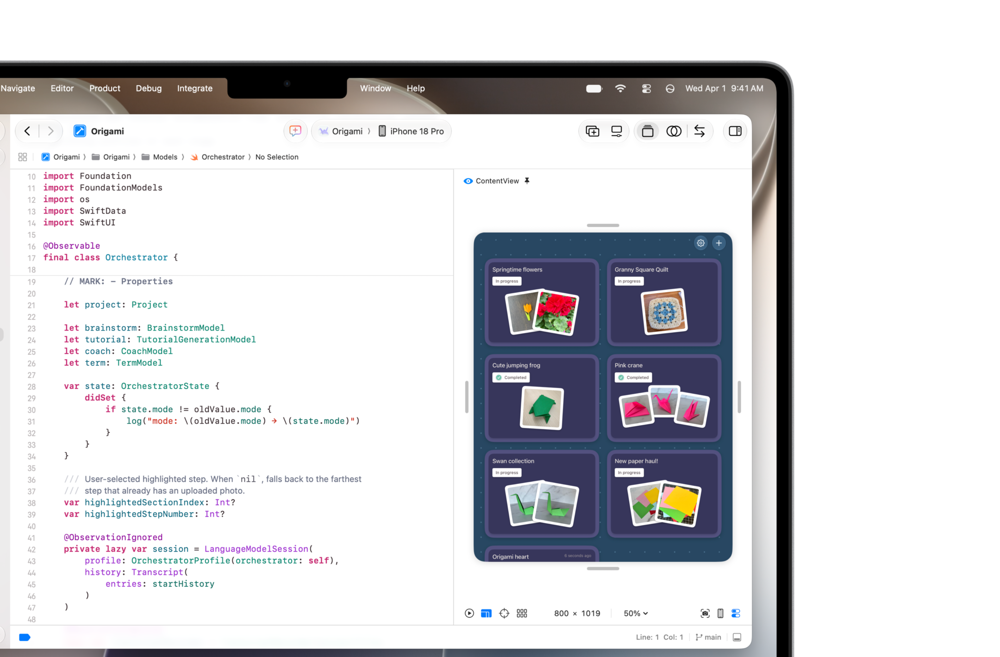

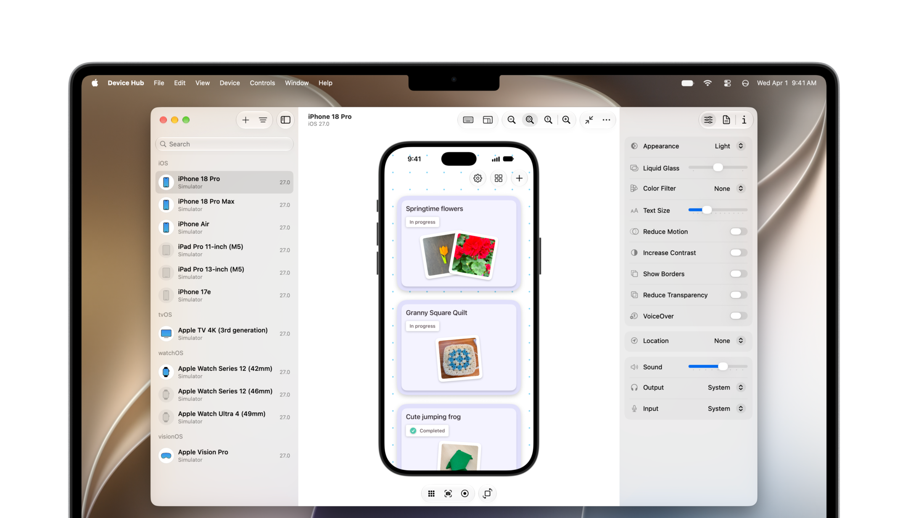

以上图证明源码、设备与预览的布局，属于键鼠环境也成立的基础设施。见 [S17]。

## 08 · 鸿蒙版 DevEco Studio：按输入差异重排机会

六项中前五项聚焦手指 / 主动笔的新增约束，最后一项属于 Fold 形态。既有 Agent 基线作为前提，不再重复计为创新。所有方案均需验证，不声称现有产品缺少同类能力。

### P0-T1 · 手指落点消歧与可达反馈

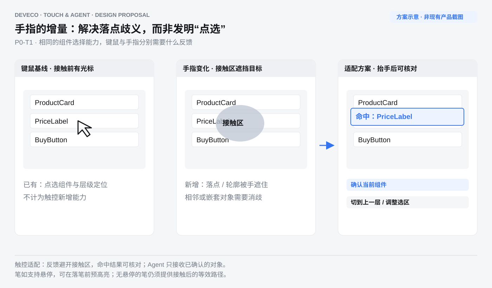

**输入触发：**手指点中密集 diff 行、嵌套组件或小图标，接触区域遮住目标。**键鼠对照：**鼠标已有视觉选择，但有光标和接触前反馈。

**新增设计：**接触后高亮实际命中对象；在手指外侧提供候选层级、选区调节和批注；菜单可见且不依赖 hover。主动笔若有 hover，可先预高亮，不能强制走同一条“无悬停”路径。

**Agent 作用：**接收确认后的对象；不要用模型猜测替代 UI 的目标消歧。**依据与验证：**见 [S05]、[S24]；比较相同视觉选择功能下的错选、选区修正与误提交，包含左右手和不同缩放。

### P0-T2 · 多触点验证与标注路由

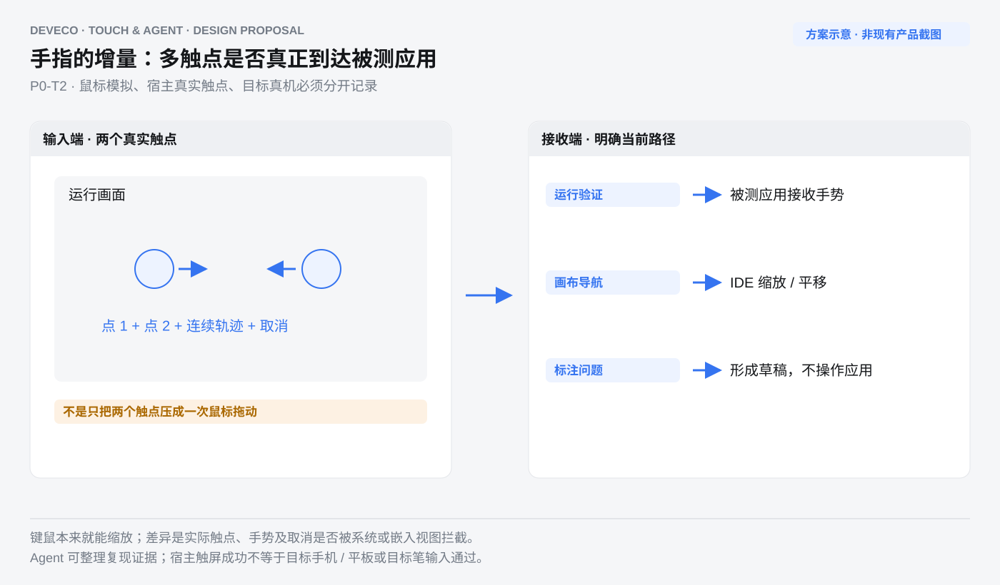

**输入触发：**直接在运行画面上双指平移、捏合或长按。**键鼠对照：**滚轮 / 触控板缩放已有；真实多触点到应用的路径需要另验。

**新增设计：**运行验证时显示输入由应用接收；进入标注 / 画布工具时显示不同状态。若嵌入视图不能透传，给出可验证的独立窗口 / 真机路径，不把手势改成鼠标点击后仍宣称多触点验证通过。

**Agent 作用：**可附上触点轨迹和目标状态形成复现证据；不能从宿主屏幕操作推定真机表现。**依据与验证：**见 [S15]、[S16]；记录输入到达层、触点数、取消与实际 UI 结果。此项为输入链路适配，非新增 Agent 推理能力。

### P0-P1 · 笔迹、手指导航与手掌取消分开处理

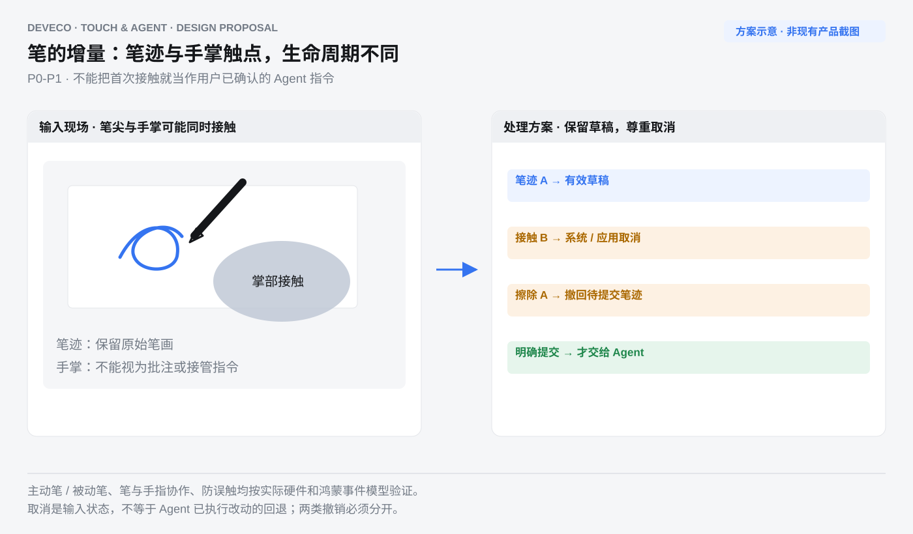

**输入触发：**持笔书写时手掌落在屏幕；手指同时碰到画布；笔迹被撤销或擦除。**键鼠对照：**普通鼠标路径不需要处理这一组笔 / 手掌输入状态。

**新增设计：**提供明确的笔迹工具；按硬件和系统实际事件区分笔、手指及被取消输入。取消的接触和被擦除的笔迹不进入批注任务。可探索“笔书写、手指导航”，但先验证防误触是否允许，不默认双手协作必然可行。

**Agent 作用：**只接收用户明确提交的有效笔迹；未完成笔迹保留本地草稿。**依据与验证：**见 [S24]、[S25]、[S27]；按鸿蒙实际事件模型验证落掌、抬笔、取消、擦除、双输入冲突与误发命令。

### P1-P2 · 笔写修改意图，先核对再执行

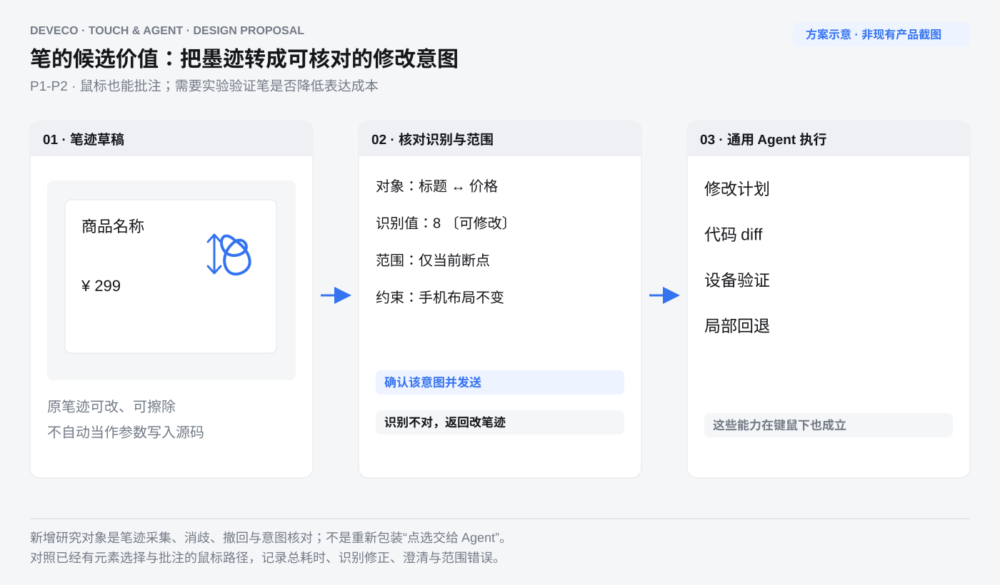

**输入触发：**在预览上用箭头标出两个间距，手写“8”，并补一句“手机保持不变”。**键鼠对照：**鼠标也能画线和打字；只有在实测减少定位 / 表达成本时，笔才有可证明的额外价值。

**新增设计：**保留原笔迹和圈定范围，显示可编辑的识别结果：“目标 A-B / 间距改为 8 / 手机不改”；不确定的数值与对象先确认。擦掉草稿应撤回相应待提交意图；已经执行的代码修改走常规 diff 回退。

**Agent 作用：**将笔迹、组件与口述约束转成修改计划，给出 diff 和验证结果。**依据与验证：**输入机制见 [S24]、[S26]，对象反馈基线见 [S10]、[S20]；比较鼠标视觉批注与笔输入的总完成时间、识别修正、澄清和范围错误。这是候选场景，不先宣称优于键鼠。

### P1-P3 · 悬停预览、笔键与擦除的条件增强

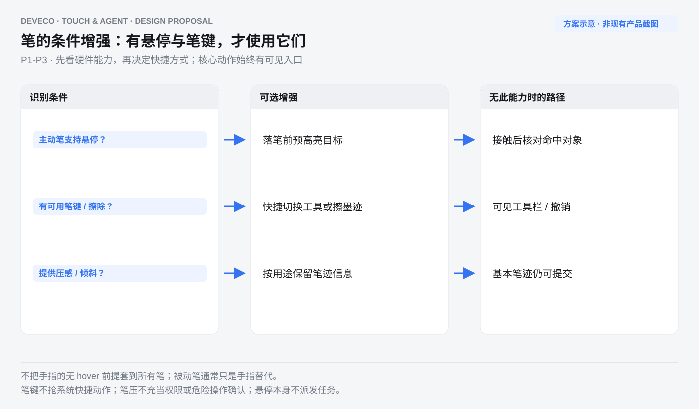

**输入触发：**兼容主动笔接近屏幕、按下工具键或使用擦除功能。**键鼠对照：**右键菜单与 hover 已有；新增的是笔设备所上报状态与工具动作的映射。

**新增设计：**有悬停就预览将作用的对象；无悬停仍可接触后确认。笔键 / 擦除功能作为可选快捷方式；保留可见工具栏，避免抢占系统已分配的快捷动作。压感 / 倾斜只在有实际用途和真实数据时使用，不拿轻重笔压充当危险操作确认。

**Agent 作用：**不直接消费未确认的悬停或笔键作为执行许可。**依据与验证：**见 [S23]—[S26]；分别测有 / 无悬停、有 / 无笔键、被动笔及笔断连，记录误切工具和无法完成的路径。具体 M-Pen 3 能力需按机型实测。

### P2-F1 · Fold 的书写姿态与任务连续性（形态因素）

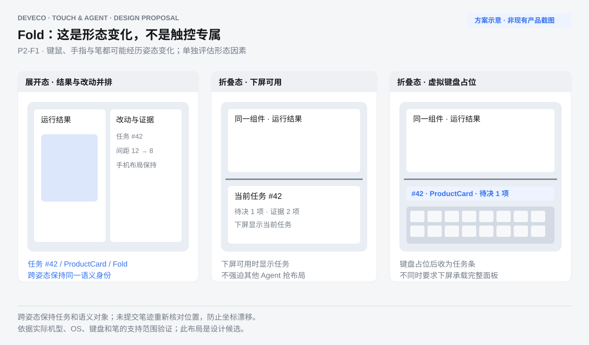

**形态触发：**展开、折叠、旋转或接入键盘；可能同时持笔，也可能全程键鼠。**归因：**这是形态与可见区问题，不能称为触控专属。

**设计：**按实际可用面积恢复任务、设备和笔迹坐标；已确认的语义对象跨姿态延续，未提交墨迹重新核对位置；下屏被键盘占用时不同时要求承载完整 Agent 面板。是否适合书写需结合屏幕姿态和硬件支持验证。

**Agent 作用：**跟随同一任务，不因姿态变化重复派发。**依据与验证：**见 [S02]—[S04]、[S23]；独立控制姿态与输入方式，检查笔迹漂移、对象丢失和恢复步骤。

## 09 · 如何证明是触控 / 笔的收益

| 实验 | 保持相同 | 只改变什么 | 观察什么 |
|---|---|---|---|
| 视觉选择 | 工程、Agent、元素选择能力与任务范围 | 鼠标 / 手指 / 主动笔 | 错选、选区修正、遮挡、误提交；不能把有无视觉选择当输入差异 |
| 批注意图 | 同一处修改、同样可用的视觉上下文 | 鼠标画线+键入 / 笔迹+文字或口述 | 总完成时间、识别修正、澄清、范围偏离；不能只比输入字符数 |
| 多触点验证 | 同一应用与版本 | 鼠标模拟 / 宿主真实触点 / 目标真机 | 触点与手势是否到达应用；宿主成功不代替真机结论 |
| 笔输入正确性 | 同一硬件、系统、模式 | 悬停 / 落笔 / 擦除 / 落掌 / 取消 | 笔迹和触点生命周期、误发任务、防误触与输入丢失 |
| Fold 因素 | 同一任务与输入方式 | 展开 / 折叠 / 键盘占位 | 坐标和任务是否恢复；不把形态收益算成笔收益 |

先做 P0 输入正确性与可完成性，再验证 P1 是否降低表达成本。P2 Fold 单独评估。设备占用、权限、审阅与回退作为各实验共同基线，不能计入触控方案的独有收益。

## 10 · 来源与限制

现有工具截图主要是通用界面证据；新增笔平台文档说明输入语义，不证明这些 IDE 已实现笔适配。MacBook 笔支持未取得官方证据；鸿蒙笔支持按机型和系统条件核查；笔悬停、压感、擦除、防误触与系统快捷键仍需实机验证。

v2 中泛化的机会已重分类：点选委派、设备接管、语音与按意图审阅回到通用基线；软键盘和 Fold 回到条件 / 形态因素。保留原图作为基础能力证据，6 张当前示意均注明输入归因与键鼠对照。

S01—S21 与 S23—S27 为官方资料；S22 为第三方 CC0 图像。研究推断、设计候选与官方已公开能力分开。所有验证建议都尚未完成实机实验。

<!-- SOURCES -->

- **S01** · [Apple · 触屏 MacBook Pro 发布](https://images.apple.com/newsroom/2026/10/apple-unveils-groundbreaking-macbook-pro-with-proled-xdr-display/) · 官方 A · 核查：2026-11-03
- **S02** · [华为 · MateBook Fold 产品页](https://consumer.huawei.com/cn/harmonyos-computer/matebook-fold-ultimate-design/) · 官方 A · 核查：2026-11-03
- **S03** · [华为 · Fold 展开态使用](https://consumer.huawei.com/cn/support/content/zh-cn16048766/) · 官方 A · 核查：2026-11-03
- **S04** · [华为 · Fold 虚拟键盘](https://consumer.huawei.com/cn/support/content/zh-cn16050601/) · 官方 A · 核查：2026-11-03
- **S05** · [Microsoft · Touch interactions](https://learn.microsoft.com/en-us/windows/apps/develop/input/touch-interactions) · 官方 A · 核查：2026-11-03
- **S06** · [OpenAI · Code review](https://learn.chatgpt.com/docs/code-review?surface=app) · 官方 A · 核查：2026-11-03
- **S07** · [OpenAI · Codex on mobile](https://learn.chatgpt.com/docs/mobile) · 官方 A · 核查：2026-11-03
- **S08** · [Anthropic · Claude Code Desktop](https://code.claude.com/docs/en/desktop) · 官方 A · 核查：2026-11-03
- **S09** · [Anthropic · Remote Control](https://code.claude.com/docs/en/remote-control) · 官方 A · 核查：2026-11-03
- **S10** · [Cursor · Design Mode](https://cursor.com/docs/agent/design-mode) · 官方 A · 核查：2026-11-03
- **S11** · [Cursor · Visual editor 发布说明](https://cursor.com/blog/browser-visual-editor) · 官方 A · 核查：2026-11-03
- **S12** · [Cursor · Browser](https://cursor.com/docs/agent/tools/browser) · 官方 A · 核查：2026-11-03
- **S13** · [Google · Android Studio Agent Mode](https://developer.android.com/studio/gemini/agent-mode) · 官方 A · 核查：2026-11-03
- **S14** · [Google · Attach an image](https://developer.android.com/studio/gemini/attach-image) · 官方 A · 核查：2026-11-03
- **S15** · [Google · Android Emulator](https://developer.android.com/studio/run/emulator) · 官方 A · 核查：2026-11-03
- **S16** · [Google · Emulator known issues](https://developer.android.com/studio/run/emulator-troubleshooting) · 官方 A · 核查：2026-11-03
- **S17** · [Apple · Xcode](https://developer.apple.com/xcode/) · 官方 A · 核查：2026-11-03
- **S18** · [华为 · DevEco Studio](https://developer.huawei.com/consumer/cn/deveco-studio) · 官方 A · 核查：2026-11-03
- **S19** · [华为 · DevEco Studio Preview](https://developer.huawei.com/consumer/cn/deveco-studio/preview/) · 官方 A · 核查：2026-11-03
- **S20** · [OpenAI · Browser / Annotation](https://learn.chatgpt.com/docs/browser?surface=app) · 官方 A · 核查：2026-11-03
- **S21** · [Anthropic · Preview, review and merge](https://claude.com/resources/articles/preview-review-and-merge-with-claude-code) · 官方 A · 核查：2026-11-03
- **S22** · [Wikideas1 · Codex 公开截图（CC0）](https://commons.wikimedia.org/wiki/File:Screenshot_of_OpenAI_Codex.png) · 第三方图像 C · CC0 · 核查：2026-11-03
- **S23** · [华为 · 手写笔与平板 / 电脑兼容表](https://consumer.huawei.com/cn/support/content/zh-cn00737675/) · 官方 A · 核查：2026-11-03
- **S24** · [Microsoft · Input primer](https://learn.microsoft.com/en-us/windows/apps/develop/input/input-primer) · 官方 A · 核查：2026-11-03
- **S25** · [Google · 大屏输入兼容与 Stylus](https://developer.android.com/develop/ui/views/touch-and-input/input-compatibility-on-large-screens) · 官方 A · 核查：2026-11-03
- **S26** · [Microsoft · Pen interactions / Windows Ink](https://learn.microsoft.com/en-us/windows/uwp/ui-input/pen-and-stylus-interactions) · 官方 A · 核查：2026-11-03
- **S27** · [Microsoft · 同时使用笔和触控的验证](https://learn.microsoft.com/en-us/windows-hardware/design/component-guidelines/simultaneous-pen-and-touch-validation) · 官方 A · 核查：2026-11-03

[S01]: https://images.apple.com/newsroom/2026/10/apple-unveils-groundbreaking-macbook-pro-with-proled-xdr-display/
[S02]: https://consumer.huawei.com/cn/harmonyos-computer/matebook-fold-ultimate-design/
[S03]: https://consumer.huawei.com/cn/support/content/zh-cn16048766/
[S04]: https://consumer.huawei.com/cn/support/content/zh-cn16050601/
[S05]: https://learn.microsoft.com/en-us/windows/apps/develop/input/touch-interactions
[S06]: https://learn.chatgpt.com/docs/code-review?surface=app
[S07]: https://learn.chatgpt.com/docs/mobile
[S08]: https://code.claude.com/docs/en/desktop
[S09]: https://code.claude.com/docs/en/remote-control
[S10]: https://cursor.com/docs/agent/design-mode
[S11]: https://cursor.com/blog/browser-visual-editor
[S12]: https://cursor.com/docs/agent/tools/browser
[S13]: https://developer.android.com/studio/gemini/agent-mode
[S14]: https://developer.android.com/studio/gemini/attach-image
[S15]: https://developer.android.com/studio/run/emulator
[S16]: https://developer.android.com/studio/run/emulator-troubleshooting
[S17]: https://developer.apple.com/xcode/
[S18]: https://developer.huawei.com/consumer/cn/deveco-studio
[S19]: https://developer.huawei.com/consumer/cn/deveco-studio/preview/
[S20]: https://learn.chatgpt.com/docs/browser?surface=app
[S21]: https://claude.com/resources/articles/preview-review-and-merge-with-claude-code
[S22]: https://commons.wikimedia.org/wiki/File:Screenshot_of_OpenAI_Codex.png
[S23]: https://consumer.huawei.com/cn/support/content/zh-cn00737675/
[S24]: https://learn.microsoft.com/en-us/windows/apps/develop/input/input-primer
[S25]: https://developer.android.com/develop/ui/views/touch-and-input/input-compatibility-on-large-screens
[S26]: https://learn.microsoft.com/en-us/windows/uwp/ui-input/pen-and-stylus-interactions
[S27]: https://learn.microsoft.com/en-us/windows-hardware/design/component-guidelines/simultaneous-pen-and-touch-validation
